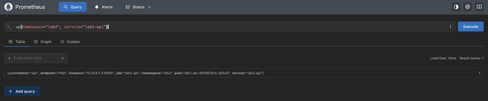
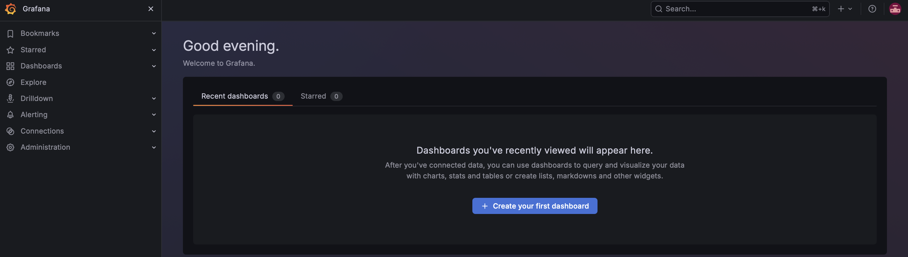
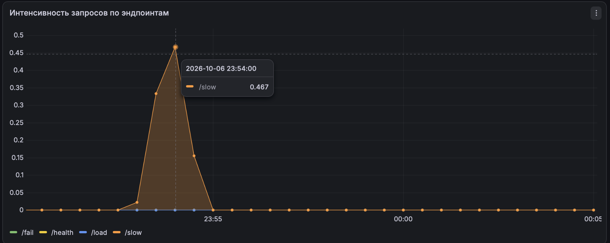
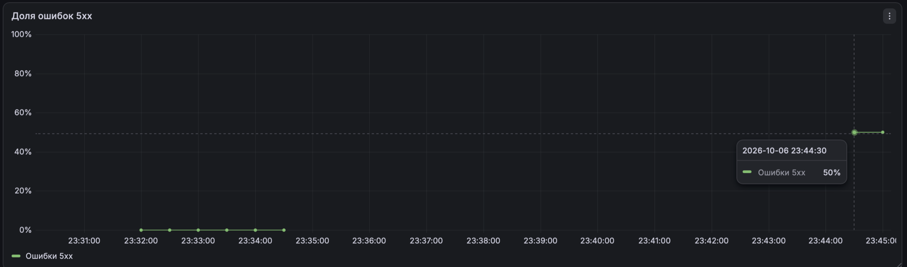
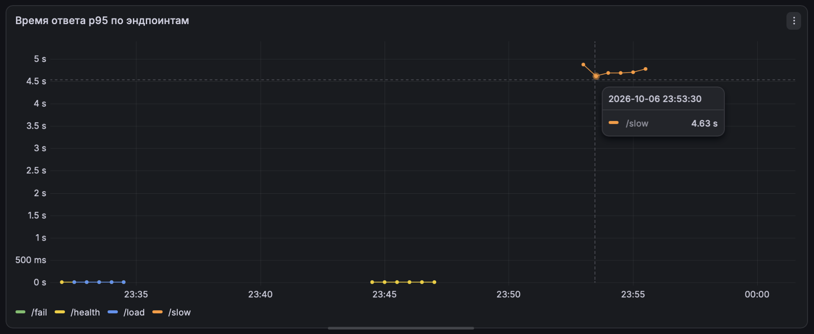
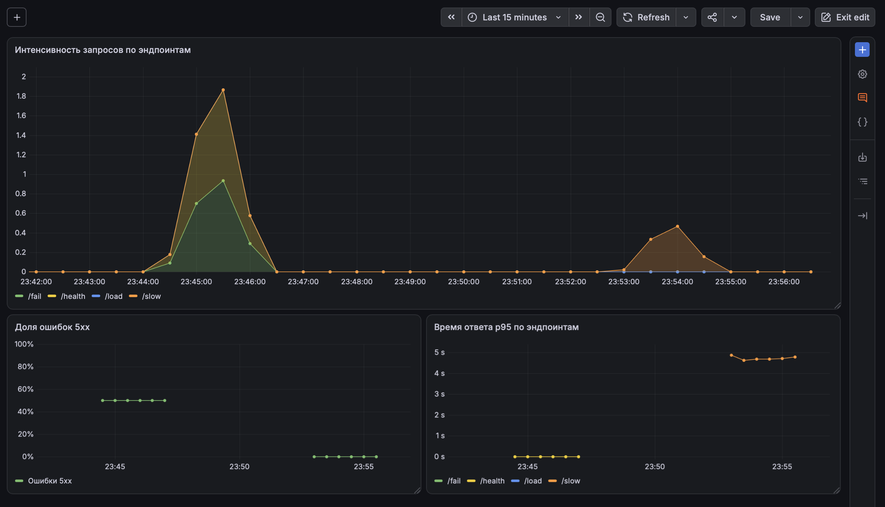
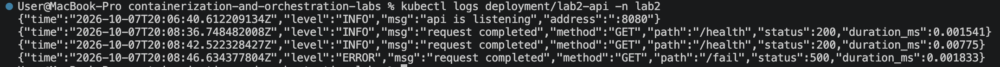
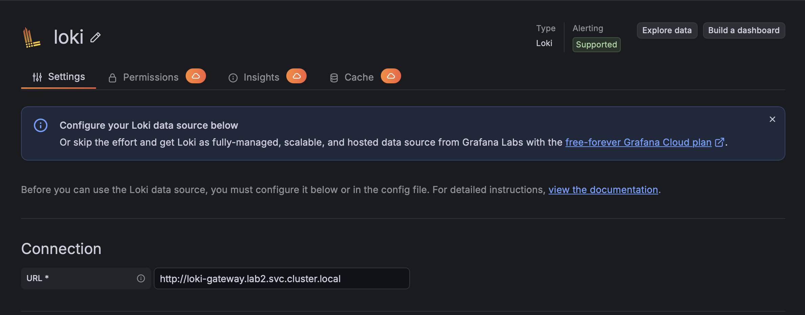
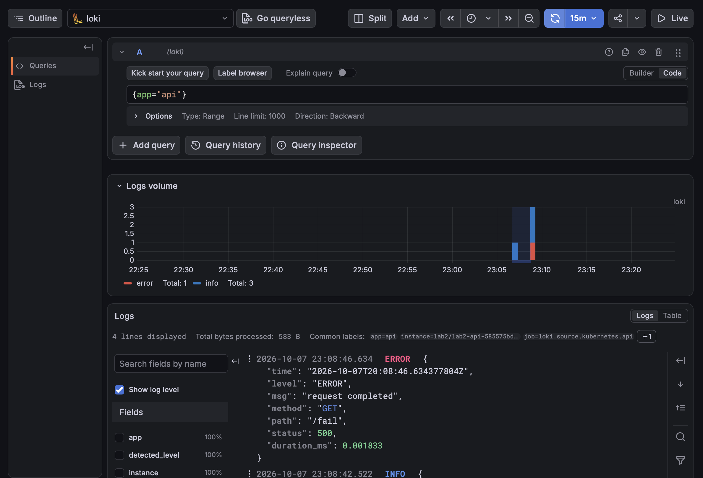

# Лабораторная работа 2 — Мониторинг сервиса: метрики, логи, трейсы

## Структура проекта

```text
lab2/
├── README.md
├── lab.md
├── api/
│   ├── Dockerfile
│   ├── go.mod
│   ├── go.sum
│   ├── main.go
├── helm/
│   ├── alloy-values.yaml
│   ├── loki-values.yaml
│   ├── monitoring-values.yaml
│   ├── api/
│   │   ├── Chart.yaml
│   │   ├── values.yaml
│   │   ├── dashboards/
│   │   │   └── red.json
│   │   └── templates/
│   │       ├── alerts.yaml
│   │       ├── dashboard.yaml
│   │       ├── deployment.yaml
│   │       ├── monitoring.yaml
│   │       └── service.yaml
│   ├── jaeger/
│   │   ├── Chart.yaml
│   │   ├── values.yaml
│   │   └── templates/
│   │       ├── configmap.yaml
│   │       ├── deployment.yaml
│   │       └── service.yaml
│   └── alerting/
│       ├── Chart.yaml
│       ├── values.yaml
│       ├── files/
│       │   └── webhook.py
│       └── templates/
│           ├── karma.yaml
│           └── webhook.yaml
├── evidence/
│   └── alertmanager-webhook.jsonl
└── images/
    ├── part1/
    ├── part2/
    ├── Part3/
    └── Part4/
```

---

# Часть 0 — Свой сервис

В качестве тестового приложения используется HTTP-сервис `api`, написанный на Go.

### Эндпоинты

| Метод | Endpoint    | Назначение                            |
| ----- | ----------- | ------------------------------------- |
| GET   | `/health`   | Проверка доступности сервиса          |
| GET   | `/fail` | Вызов ошибки 5xx и увеличение счетчика ошибок  |
| GET   | `/slow`     | Медленный ответ (спит 1-3 секунды) |
| GET   | `/load`   | Запросы к себе для повышения RPS |
| GET   | `/metrics`   | Метрики для Prometheus |

### Метрики

| Метрика | Назначение |
| ----- | ----------- |
| `http_requests_total` | Накопленное число обработанных запросов |
| `http_errors_total` | Накопленное число ответов со статусом 5xx |
| `http_request_duration_seconds` | Распределение длительности запросов |

---

# Часть 1 — Метрики (Prometheus + Grafana)

Через Helm-чарт были установлены Prometheus, Grafana, Prometheus Operator и Alertmanager, все настройки были вынесены в отдельный файл `helm/monitoring-values.yaml`

```bash
helm upgrade --install monitoring prometheus-community/kube-prometheus-stack \
  --namespace lab2 --create-namespace --values ./helm/monitoring-values.yaml
```

Для сбора метрик был обавлен объект ServiceMonitor, который необходим для подключения api к Prometheus. Его настройки лежат в файле `helm/api/templates/monitoring.yaml`


## Настройка доступов к Prometheus и Grafana

После запуска Prometheus стал доступен на 9090 порту. В качестве теста корректного подключения был выполнен запрос на проверку доступности lab2



Далее была запущена Grafana на 3000. В качестве источника данных конечно же использовался Prometheus




## Интенсивность запросов

Через визуальный редактор Builder была выбрана метрика `http_requests_total`, которая показывала накопленное число запросов. Затем была добавлена операция rate, которая рассчитывает среднее увеличение счетчика за 1 секунду.

Для проверки выполнялись повторные вызовы `/load`, каждый вазов создавал 20 дополнительных запросов к /health, и в результате на графике наблюдался рост интенсивности.




## Доля запросов 5хх

Следующий показатель рассчитывается как отношение интенсивности ошибочных запросов к интенсивности всех запросов в процентном соотношении `Percent (0-100)`. 

Проверка проводилась чередованием успешных и ошибочных запросов. При равном количестве успешных и ошибочных запросов показатель достиг примерно 50%




## Время ответа p95

Третья панель содержала в себе гистограмму длительности запросов. Разделение по адресам позволяет наблюдать задержки `/slow` независимо от большого числа быстрых запросов `/health`.

Для проверки выполнялись 30 последовательных вызовов, а на графике появилась линия `/slow` со значительно большим временем ответа, чем у быстрых обработчиков. Полученная оценка p95 составила около 4.75 секунды, хотя заданная задержка равна 1-3 секундам. Важно отметить, что такое расхождение связано с интервалами стандартной гистограммы, и запросы длительностью около 3х секунд попадают в интервал 2.5-5 секунд.




## Helm-конфигурация

Для удобного и быстрого развертывания в будущем, дашборд был экспортирован из Grafana в json и сохранен в проекте в файле `helm/api/dashboards/red.json`

А в Helm-чарт добавляется шаблон ConfigMap, который и содержит json дашборда. Так описание панелей хранится вместе с конфигурацией проекта и может быть повторно загружено в момент развертывания.

В результате получился во такой дашборд




# Часть 2 — Логи (Loki + Grafana)
Первым делом было добавлено логирование с помощью стандартной библиотеки log/slog. Логирование запросов было добавлено в функцию `observe()`, которая записывает следующие поля:

| Поле | Назначение |
| ----- | ----------- |
| `time` | Время записи |
| `level` | Уровень |
| `msg` | Описание события |
| `method` | HTTP-метод |
| `path` | Эндпоинт |
| `status` | Статус ответа |
| `duration_ms` | Длительность обработки запроса |


Ответы со статусом 500 и выше записываются с уровнем ERROR, а остальные – с уровнем INFO. Пример лога:
```json
{"time":"2026-10-07T20:08:46.634377804Z","level":"ERROR","msg":"request completed","method":"GET","path":"/fail","status":500,"duration_ms":0.001833}
```

## Подготовительный этап
После изменения кода был собран новый Docker-образ, а также обновлен Helm-релиз. В качестве тестов были дернуты эндпоинты, чтобы убелиться, что JSON-записи успешно создаются:



Все настройки Loki сохранены в `helm/loki-values.yaml`: прием, хранение и поиск логов выполняются одним процессом Loki, дополнительно были отключены группы backend, read и write, а также отключены дополнительные кеши для ускоренной загрузки образа (в рамках данной лабораторной работы они нам не потребовались и лишь съедали бы ресурсы)

Дополнительно установлен агент Grafana Alloy для сбора и отправки логов в Loki. Grafana запрашивает записи из Loki для отображения. В конфиге агента (файл `helm/alloy-values.yaml`) содержится три основных компонента: discovery.kubernetes (ищет поды api), loki.source.kubernetes (читает логи через Kubernetes API), loki.write (отправляет записи в Loki). Alloy развернут как DaemonSet, а поиск ограничен подами с меткой `app=api` в namespace `lab2` на своей ноде, чтобы агенты не дублировали сбор.

## Loki + Grafana
В существующую Grafana был добавлен источник данных Loki



После проверки подключения настройки источника были сохранены файле `helm/monitoring-values.yaml`, а затем были вызваны эндпоинты для получения логов в Grafana. В разделе Explore был выбран источник Loki и отправлен запрос `{app="api"}`. В результате все логи (и старые, и новые) успешно отобразились в панели мониторинга:



# Часть 3 — Трейсы (OpenTelemetry + Jaeger)

В этой части сервис был инструментирован OpenTelemetry, а для приема, хранения и просмотра трейсов развернут Jaeger. Метрики показывают общую интенсивность запросов, ошибки и задержки, а трейс позволяет разобрать выполнение конкретного запроса и увидеть, на какую операцию ушло время.

## Инструментирование API

В `api/main.go` подключены OpenTelemetry SDK, HTTP-инструментарий `otelhttp` и OTLP/HTTP-экспортер. Обработчики `/health`, `/fail`, `/slow` и `/load` обернуты в `otelhttp.NewHandler`: библиотека создает серверный спан и помещает его в контекст запроса. Если входящий запрос уже содержит trace context, серверный спан продолжает существующий трейс. Эндпоинт `/metrics` оставлен без трассировки, чтобы опросы Prometheus не заполняли хранилище трейсов.

В обработчиках добавлены следующие действия:

| Обработчик | Что записывается в трейс |
| --- | --- |
| `/slow` | Вложенный спан `slow-op` вокруг задержки на 1–3 секунды; атрибут `sleep.duration_ms` содержит заданную задержку |
| `/fail` | Статус спана `Error` и событие исключения с сообщением `intentional failure from /fail` |
| `/load` | Инструментированный HTTP-клиент передает контекст во внутренние запросы `/health`, связывая их с исходным запросом |

Функция `observe()` получает контекст запроса и добавляет в JSON-лог `trace_id` и `span_id`. Эти идентификаторы связывают запись лога с конкретным трейсом и спаном. У служебных сообщений вне HTTP-запросов, например при запуске приложения, текущего спана нет.

В учебном стенде включен `AlwaysSample`, чтобы сохранялись все инструментированные запросы. Спаны отправляются пакетами; при штатном завершении API выполняется сброс накопленных трейсов.

## Развертывание Jaeger и обновление API

Для Jaeger создан отдельный Helm-чарт `helm/jaeger`. Он разворачивает Jaeger `2.22.0` в одном Pod: OTLP-приемник, хранилище в памяти и интерфейс поиска работают вместе. Конфигурация хранится в ConfigMap и передается процессу через `--config`.

| Параметр | Значение |
| --- | --- |
| Прием трейсов | OTLP/HTTP, порт `4318` |
| Web UI | Порт `16686` |
| Хранилище | В памяти, до 5000 трейсов |
| Ресурсы | Requests: 100m CPU и 128Mi памяти; лимит памяти: 512Mi |

Хранение в памяти подходит для демонстрации: отдельная база данных не требуется, но после перезапуска Pod трейсы теряются.

В `helm/api/values.yaml` указан образ `lab2-api:traces` и настройки трассировки. Шаблон Deployment передает их контейнеру как переменные окружения:

```text
OTEL_SERVICE_NAME=api
OTEL_EXPORTER_OTLP_ENDPOINT=http://jaeger.lab2.svc.cluster.local:4318
```

Таким образом, API отправляет спаны напрямую в Jaeger внутри кластера. Alloy продолжает собирать логи и в передаче трейсов не участвует.

Команды выполнялись из директории `lab2` при уже работающем Minikube и установленном стеке метрик и логов:

```bash
docker build -t lab2-api:traces ./api
minikube image load lab2-api:traces

helm upgrade --install jaeger ./helm/jaeger -n lab2 --wait --timeout 5m
helm upgrade --install api ./helm/api -n lab2 --wait --timeout 5m
```

Образ загружен внутрь Minikube, поскольку в чарте API используется `imagePullPolicy: Never`. При установке Helm в нашем окружении возникал `EOF` при обращении к Kubernetes API через прокси. Для устранения ошибки команды Helm и kubectl запускались с префиксом:

```bash
env -u HTTP_PROXY -u HTTPS_PROXY -u ALL_PROXY \
    -u http_proxy -u https_proxy -u all_proxy <команда>
```

Доступ к Jaeger и API был открыт через port-forward. Каждая команда остается работать в отдельном терминале:

```bash
minikube kubectl -- port-forward -n lab2 svc/jaeger 16686:16686
```

```bash
minikube kubectl -- port-forward -n lab2 svc/api-api 8081:8080
```

Jaeger UI доступен по `http://localhost:16686`. Для API использован локальный порт `8081`, поскольку `8080` был занят предыдущим port-forward. При отказе доступа к Docker в новом терминале выполнялась команда `newgrp docker`, активирующая уже добавленное членство пользователя в группе.

## Трейс медленного запроса

Для проверки вызван эндпоинт `/slow`:

```bash
curl --noproxy '*' http://localhost:8081/slow
```

После отправки спанов в Jaeger выбран сервис `api` и операция `GET /slow`. Поиск показал трейс с двумя спанами и длительностью около одной секунды:


В водопаде видно, что `slow-op` вложен в серверный спан `GET /slow` и занимает почти всю его длительность. Это подтверждает, что основное время запроса ушло на искусственную задержку внутри обработчика.


## Ошибочный трейс и связь с логами

Далее вызван `/fail`, который вернул ожидаемый HTTP 500:

```bash
curl --noproxy '*' -i http://localhost:8081/fail
```

В Grafana Explore выбран источник Loki и выполнен запрос:

```logql
{app="api"} | json | path="/fail"
```

В свежей записи присутствуют уровень `ERROR`, путь `/fail`, статус `500` и идентификаторы:

```text
trace_id: 426f0f7f9e629bb28032a4610abb180f
span_id:  ce7f445e68397985
```


Значение `trace_id` из лога использовано для открытия того же запроса в Jaeger через поле поиска по ID или URL `/trace/<trace_id>`. В интерфейсе появился трейс `GET /fail` длительностью 256 мкс, с красной отметкой ошибки и HTTP-статусом 500:


В деталях спана видны `error=true`, событие `exception` и сообщение `intentional failure from /fail`. Идентификатор спана `ce7f445e68397985` совпадает с `span_id` из Loki:


Таким образом, проверены вложенность медленной операции, пометка ошибочного запроса и переход от конкретной строки лога к соответствующему трейсу. Поиск по ID выполнялся вручную; автоматическая ссылка из Grafana в Jaeger не настраивалась.

# Часть 4 — Алерты (Alertmanager + Karma)

В этой части настроены три критичных алерта, доставка уведомлений в webhook и отображение активных алертов в Karma. Alertmanager уже был установлен вместе с `kube-prometheus-stack`.

Роли компонентов разделены следующим образом:

```text
Prometheus вычисляет правила → Alertmanager группирует алерты
                                      ├→ webhook принимает уведомления
                                      └← Karma запрашивает активные алерты
```

## Правила и выбор порогов

Правила описаны в `helm/api/templates/alerts.yaml` как ресурс `PrometheusRule`. Метка `release: monitoring` позволяет Prometheus Operator выбрать этот ресурс. Пороги вынесены в секцию `alerts` файла `helm/api/values.yaml`.

Все три правила имеют метки `severity=critical`, `app=api`, `namespace=lab2` и `service=api-api`. Группа `lab2-api` вычисляется каждые 15 секунд. Условие должно сохраняться в течение `for: 2m`: сначала алерт находится в `pending`, затем переходит в `firing`.

| Алерт | Условие | Почему это критично | Действия дежурного |
| --- | --- | --- | --- |
| `ApiHighErrorRate` | Доля ответов 5xx за окно 2 минуты выше 10%, при интенсивности не менее 0.1 запроса/с | Существенная часть пользовательских операций завершается ошибкой | Проверить логи, найти ошибочные трейсы по `trace_id`, проверить зависимости и последние изменения приложения |
| `ApiHighLatency` | p95 по отдельному эндпоинту за окно 2 минуты выше 1 секунды, при интенсивности этого эндпоинта не менее 0.1 запроса/с | Пользователь ждет ответа слишком долго; возможны таймауты клиентов и накопление запросов | Определить `path` из меток алерта, открыть медленный трейс, проверить долгую операцию, ресурсы и зависимости |
| `ApiUnavailable` | Нет ни одного успешно опрашиваемого экземпляра API либо все цели исчезли из обнаружения | Возможна полная недоступность сервиса | Проверить Deployment, реплики, Pod, события, Service и EndpointSlice, доступ к `/health` и `/metrics`; восстановить API |

Порог задержки в 1 секунду принят как учебное требование к API, а `/slow` намеренно его нарушает. На реальном проекте пороги выбирались бы из SLO и требований пользователей. Ограничение минимальной интенсивности снижает вероятность срабатывания по единичному запросу. p95 рассчитывается по гистограмме и зависит от границ бакетов, поэтому точную длительность отдельного запроса проверяем в Jaeger.

Доля ошибок вычисляется как отношение `sum(rate(http_requests_total{status=~"5.."}[2m]))` к скорости всех запросов с фильтрами namespace и service. Для задержки используется `histogram_quantile(0.95, ...)` с группировкой по `le` и `path`: большое число быстрых запросов `/health` не скрывает медленный `/slow`.

Для недоступности используется выражение:

```promql
(sum(up{namespace="lab2",service="api-api"}) or vector(0)) == 0
```

`up` равно 1 при успешном scrape и 0 при неудачном. Если все Pod удалены, временные ряды целей могут исчезнуть; `or vector(0)` позволяет обнаружить и этот случай. Успешный scrape подтверждает доступность `/metrics`, но не доказывает исправность всех пользовательских операций — ошибки и задержки контролируются отдельными правилами.

После обновления Helm-релиза API правила появились в разделе Alerts Prometheus. До создания нагрузки все три находились в состоянии `inactive`:


## Получатель уведомлений и Karma

Для новых компонентов создан Helm-чарт `helm/alerting`. Он разворачивает два Deployment с Service:

- `alerting-webhook` — небольшой HTTP-сервис на Python, код которого хранится в ConfigMap. Принимает POST `/alerts`, выводит JSON уведомления в stdout и отвечает HTTP 200. Это позволяет проверить фактическую доставку без подключения внешней почты или мессенджера.
- `alerting-karma` — Karma `v0.133`, подключенная к `http://monitoring-kube-prometheus-alertmanager.lab2.svc.cluster.local:9093` через переменную `ALERTMANAGER_URI`.

В `helm/monitoring-values.yaml` добавлена конфигурация Alertmanager. Алерты с метками `app="api"` и `namespace="lab2"` направляются получателю `lab2-webhook` по адресу `http://alerting-webhook.lab2.svc.cluster.local:8080/alerts`. Остальные попадают в получатель `null`, который не отправляет уведомления; при этом такие алерты могут отображаться в интерфейсах.

Для группировки используются `namespace`, `alertname` и `service`. Первая отправка задерживается на `group_wait: 10s`, изменения группы отправляются с интервалом `group_interval: 30s`, повторные уведомления — с `repeat_interval: 5m`. Параметр `send_resolved: true` включает отправку уведомления о прекращении срабатывания.

Установка выполнена из директории `lab2`:

```bash
helm upgrade --install alerting ./helm/alerting -n lab2 --wait --timeout 5m

helm upgrade monitoring prometheus-community/kube-prometheus-stack \
  -n lab2 --reuse-values -f ./helm/monitoring-values.yaml \
  --wait --timeout 10m
```

В нашем окружении применялся описанный в части 3 префикс `env -u ...`, чтобы локальные обращения к Kubernetes API не шли через прокси.

Для просмотра использованы следующие пробросы портов, каждый в отдельном терминале:

```bash
minikube kubectl -- port-forward -n lab2 svc/monitoring-kube-prometheus-prometheus 9090:9090
minikube kubectl -- port-forward -n lab2 svc/monitoring-kube-prometheus-alertmanager 9093:9093
minikube kubectl -- port-forward -n lab2 svc/alerting-karma 8082:8080
```

В Karma (`http://localhost:8082`) установлен фильтр `app=api`. В Alertmanager (`http://localhost:9093`) добавлен matcher `app="api"` без фигурных скобок. Эти фильтры отделяют алерты нашего сервиса от штатных алертов кластера.

## Проверка ошибок и задержки

Для создания нагрузки использовался цикл с чередованием `/fail` и `/slow`:

```bash
for i in {1..100}; do
  curl --noproxy '*' -sS --max-time 5 http://localhost:8081/fail > /dev/null
  curl --noproxy '*' -sS --max-time 5 http://localhost:8081/slow > /dev/null
  sleep 1
done
```

При такой нагрузке примерно половина запросов возвращает 500, а задержка `/slow` превышает установленный порог. После выдержки оба алерта перешли в `firing`; `ApiUnavailable` оставался неактивным, поскольку сервис продолжал отвечать:


В Karma появились две отдельные группы. В них видны серьезность, описание проблемы, действия дежурного и метка `path=/slow` у алерта задержки:


Доставку проверили по логам получателя:

```bash
minikube kubectl -- logs -n lab2 deployment/alerting-webhook --tail=20
```

В stdout появились записи `event=alert_notification`, `receiver=lab2-webhook`, `status=firing` для `ApiHighErrorRate` и `ApiHighLatency`. Таким образом, подтверждено не только вычисление правил, но и получение уведомлений отдельным сервисом:


Оба алерта также зафиксированы в штатном интерфейсе Alertmanager с получателем `lab2-webhook`:


## Проверка полной недоступности

После остановки цикла число реплик API временно уменьшено до нуля через Helm:

```bash
helm upgrade api ./helm/api -n lab2 --set replicaCount=0 --wait --timeout 5m
```

Pod исчез, и после выдержки сработал `ApiUnavailable`. Алерты ошибок и задержки погасли: без запросов условия их минимальной интенсивности перестали выполняться. Это само по себе не означает исправность сервиса — недоступность контролируется третьим правилом.


После фиксации результатов API восстановлен:

```bash
helm upgrade api ./helm/api -n lab2 --set replicaCount=1 --wait --timeout 5m
```

Обновление завершилось успешно, релиз `api` получил статус `deployed` и ревизию 7. После возобновления успешного scrape условие недоступности перестало выполняться, и webhook получил уведомление `resolved`.

## Подтверждение доставки и восстановления

Полный полученный вывод сохранен в [evidence/alertmanager-webhook.jsonl](evidence/alertmanager-webhook.jsonl). Файл содержит 10 JSON-уведомлений, включая повторную проверку ошибок и задержки. Для каждого из трех алертов присутствуют состояния `firing` и `resolved`.

| Алерт | Получено первое `firing` | Получено `resolved` для этой проверки |
| --- | --- | --- |
| `ApiHighErrorRate` | 12.10.2026, 03:54:34 | 12.10.2026, 03:58:34 |
| `ApiHighLatency` | 12.10.2026, 03:54:49 | 12.10.2026, 03:58:49 |
| `ApiUnavailable` | 12.10.2026, 04:10:49 | 12.10.2026, 04:13:49 |

В таблице указано московское время получения уведомлений (UTC+3); исходные JSON-записи содержат UTC. У `ApiUnavailable` поле `endsAt` равно `2026-10-12T01:13:39.002Z`, а сообщение о восстановлении получено в `2026-10-12T01:13:49.021414+00:00`. Проверка охватила полный цикл: возникновение условия → `firing` → доставка → восстановление API → доставка `resolved`.

# Результат лабораторной

В Kubernetes через Helm развернуты API и стек мониторинга: Prometheus, Grafana, Loki, Alloy, Jaeger, Alertmanager, Karma и webhook-получатель. Проверены RED-метрики, поиск ошибки в логах, медленный и ошибочный трейсы, связь лога с трейсом по ID, срабатывание трех критичных алертов и доставка уведомлений об их снятии. После эксперимента API восстановлен до одной реплики.
