# Лабораторная работа 3 — Собери платформу для shop

## Структура проекта

```text
lab3/
├── Dockerfile
├── README.md
├── go.mod
├── go.sum
├── services/
│   ├── api/
│   │   └── main.go
│   └── worker/
│       └── main.go
├── policies/
│   ├── no-latest.yaml
│   ├── no-privileged.yaml
│   ├── require-app-label.yaml
│   ├── require-limits.yaml
│   ├── require-non-root.yaml
│   └── tests/
│       ├── no-app-label.yaml
│       ├── no-limits.yaml
│       ├── latest.yaml
│       ├── privileged.yaml
│       ├── root.yaml
│       └── valid-pod.yaml
├── helm/
│   └── shop/
│       ├── Chart.yaml
│       ├── values.yaml
│       └── templates/
│           ├── api-deployment.yaml
│           ├── api-service.yaml
│           ├── grafana-dashboard.yaml
│           ├── postgres-cluster.yaml
│           ├── prometheus-rule.yaml
│           ├── service-monitor.yaml
│           ├── worker-deployment.yaml
│           └── worker-service.yaml
├── images/
│   ├── part0/
│   ├── part1/
│   ├── part2/
│   ├── part3/
│   ├── part4/
│   └── part5/
```

---

# Часть 0 — Сервис

### Описание сервисов

| Сервис | Назначение  |
| ----- | ----------- |
| `api`   |  HTTP-сервис для создания и получения заказов   |
| `worker`   | фоновый обработчик, который читает заказы из PostgreSQL и помечает их обработанными |

При запуске автоматически создается таблица `orders` (если она отсутствует), для заказа сохраняются id, название, статус обработки и время создания. Worker раз в две секунды выбирает один необработанный заказ и устанавливает новый статус `processed=true`.

### Проверка создания и обработки заказов

Был создан тестовый заказ, успешно получен HTTP 201 и запись со значением `processed=false`


После запуска worker у созданного заказа значение изменилось на `processed=true`. В логах worker появилась запись `order processed` с идентификатором и названием заказа:


Отдельно проверен запрос `/health` с переменной `HEALTH_FAIL=true`, вернулся HTTP 503 и сообщение `health check failed`. 


---

# Часть 1 — Ограждения на кластер

### Выбор движка
На выбор были предоставлены 2 движка: Kyverno и OPA / Gatekeeper. В рамках данной лабораторной работы для проверки ресурсов был выбран Kyverno, который позволяет описывать политики в YAML без изучения отдельного языка Rego, используемого OPA/Gatekeeper. Он не потребляет много ресурсов и довольно прост, что подходит для небольшого локального проекта. Если бы речь шла не о лабораторной, а о полноценной корпоративной инфраструктуре, стоило бы отдельно сравнить оба варианта с учётом требований проекта.

### Реализованные правила

Все политики описаны объектами `ClusterPolicy`, из проверки исключены `kube-system`, `kube-public`, `kube-node-lease` и `kyverno`, чтобы ограничения не блокировали работу и восстановление системных компонентов.

В общем Minikube-кластере для namespace `lab2` задано `failureActionOverrides: Audit`: существующий стек мониторинга не везде соответствует требованиям к лимитам, метке `app` и `runAsNonRoot`. Нарушения в `lab2` регистрируются без блокировки создания Pod. Для `lab3` и остальных неизъятых namespace действует `Enforce`. Это явное исключение из блокирующего режима для ранее установленного стека, а не подтверждение его соответствия политикам.

| Политика | Проверка | Обоснование |
| --- | --- | --- |
| `require-limits` | У каждого контейнера указаны лимиты CPU и памяти | Ограничивает потребление ресурсов контейнером |
| `require-app-label` | У pod есть непустая метка `app` | Позволяет определить принадлежность pod к приложению и фильтровать ресурсы |
| `no-privileged` | У контейнеров запрещено `privileged: true` | Ограничивает расширенный доступ контейнеров к ресурсам нод |
| `require-non-root` | На уровне pod задано `runAsNonRoot: true`, запрещено явно использовать UID 0 | Снижает риски запуска процессов с правами root |
| `no-latest` | У обычных и init-контейнеров указан явный тег образа, отличный от `latest` | Требует явно указывать используемую версию образа |


### Тестирование

Подготовлены пять тестовых манифестов, каждый из которых нарушает одно правило и соответствует остальным:

| Тестовый файл | Нарушение |
| --- | --- |
| `no-limits.yaml` | Отсутствуют лимиты CPU и памяти |
| `no-app-label.yaml` | Отсутствует метка `app` |
| `privileged.yaml` | Установлено `privileged: true` |
| `root.yaml` | Заданы `runAsNonRoot: false` и `runAsUser: 0` |
| `latest.yaml` | Используется `busybox:latest` |


Результаты запусков тестов:

```bash
minikube -p minikube kubectl -- apply -f policies/tests/no-limits.yaml
```


```bash
minikube -p minikube kubectl -- apply -f policies/tests/no-app-label.yaml
```


```bash
minikube -p minikube kubectl -- apply -f policies/tests/privileged.yaml
```


```bash
minikube -p minikube kubectl -- apply -f policies/tests/root.yaml
```


```bash
minikube -p minikube kubectl -- apply -f policies/tests/latest.yaml
```


### Проверка корректного pod

Отдельно был собран и проверен полностью соответствующий всем политикам `valid-pod.yaml`, чтобы убедиться, что все тесты успешно отработают:
- указана метка `app`
- заданы лимиты CPU и памяти
- используется образ `busybox:1.37.0`
- включен `runAsNonRoot` и задан UID 65532
- привилегированный режим отключен


# Часть 2 — Чарт api и worker

Для каждого приложения предусмотрены deployment (управляет количеством реплик и их обновлением) и service (доступ к готовым pod). Основные параметры вынесены в `values.yaml`, а все шаблоны соответствуют политикам из части 1.

### Установка чарта

Перед установкой были проверены структура чарта и манифесты:
```bash
helm lint ./helm/shop
helm template shop ./helm/shop -n lab3
```

В результате были получены три готовые реплики api и две реплики worker:


### Проверка чарта

Далее были дернуты запросы для проверки работоспособности. api вернул 200 на проверку здоровья и 201 при создании заказа, а после обработки worker у нового заказа значение `processed` изменилось на `true`.


### Проверка reconciliation

Далее вручную был удален один pod и в результате ReplicaSet создал замену с новым именем:


Deployment восстановил состояние `READY 3/3`. Таким образом, удаление отдельного pod не изменяет установленное число реплик благодаря автоматическому созданию замены.


Затем в `values.yaml` было изменено значение `api.replicas` с 3 на 4. Как итог, появилась дополнительная реплика, а deployment достиг состояния `READY 4/4`.


В конце значение возвращено к 3 и повторно выполнено обновление Helm. Число реплик вернулось к `READY 3/3`.


### Проверка rolling update

В код api добавлена отметка версии `v2` в сообщении о запуске, собран и загружен новый образ:

```bash
docker build --target api -t lab3-api:v2 .
minikube -p minikube image load lab3-api:v2
```

Для проверки доступности во время обновления из ноды Minikube запущен цикл запросов к ClusterIP Service `shop-api`. В `values.yaml` тег api заменен на `v2`, после чего выполнен `helm upgrade`. По завершении получились три готовых pod с образом `lab3-api:v2`:


### Проверка со сломанным обновлением

Перед проверкой был выкачен список `helm history` для определения последним успешным релизом:
```bash
helm history shop --kube-context minikube -n lab3
```

А в `values.yaml` установлено:
```yaml
healthFail: true
```

Новый pod начал возвращать 503 на `/health` и не прошел проверку. Обновление было остановлено, три старые исправные реплики продолжили работать, а новая оставалась неготовой:


Проверка rollout завершилась ожидаемым таймаутом:


### Helm rollback

Для восстановления выполнен откат на успешную ревизию, выбранную перед проверкой. После отката api вернулся в состояние `3/3`, worker остался в состоянии `2/2`, а в истории helm появилась новая запись.


# Часть 3 — PostgreSQL через CloudNativePG

Оператор CloudNativePG установлен отдельным Helm-релизом `cnpg` в namespace `cnpg-system`. После установки его Deployment готов, Pod работает, а CRD `clusters.postgresql.cnpg.io` зарегистрирован в Kubernetes API.

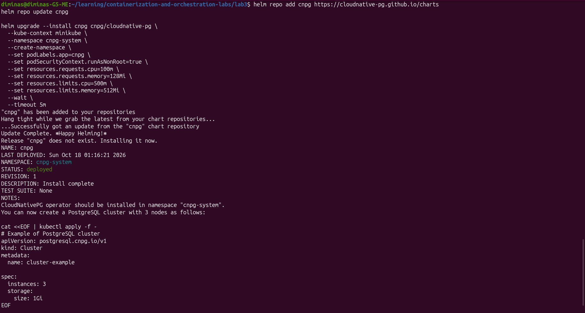

В чарт `shop` добавлен объект `Cluster` с одним экземпляром PostgreSQL, базой и владельцем `shop`, PVC на 1 GiB и лимитами ресурсов. Метка `app: postgres` передаётся дочерним ресурсам через `inheritedMetadata` для соответствия политикам Kyverno. Оператор создал Pod PostgreSQL, PVC, сервисы чтения/записи и Secret приложения.

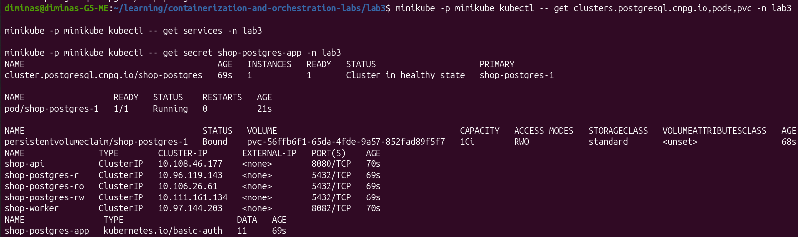

После подключения секрета CloudNativePG Helm-релиз `shop` обновлён с параметрами по умолчанию. В результате готовы три реплики API, две реплики worker и один экземпляр PostgreSQL.

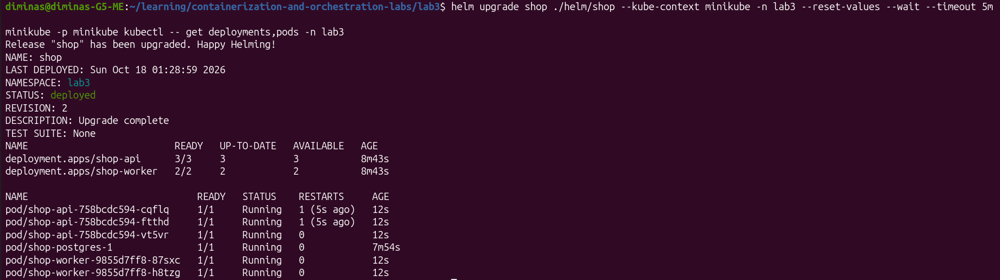

API и worker получают `DATABASE_URL` из ключа `uri` секрета `shop-postgres-app`, созданного оператором. Проверка показала HTTP 201 при создании заказа `cnpg-test` и последующее изменение `processed` на `true`.

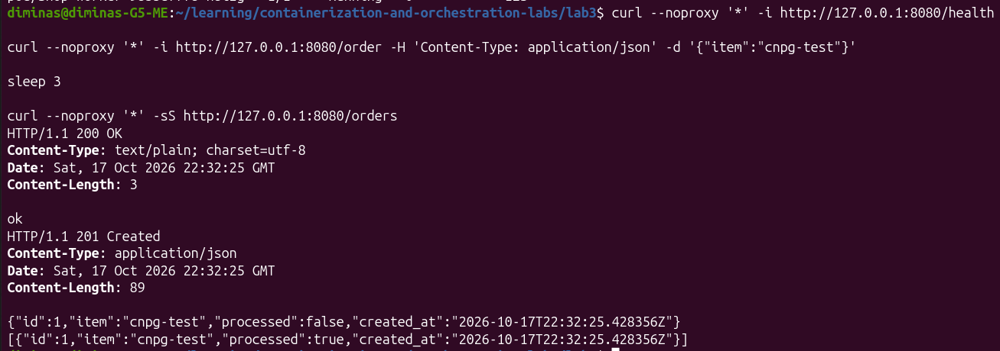

### Reconciliation PostgreSQL

Pod `shop-postgres-1` был удалён вручную. CloudNativePG обнаружил расхождение с `spec.instances: 1` и создал Pod заново. Имя осталось прежним, но UID изменился с `2d3e3eb6-776c-4b0b-8f4e-42e6efcc5253` на `3d935e52-d172-4e98-a354-4146498586d9`, что подтверждает создание нового объекта, а не перезапуск старого контейнера.

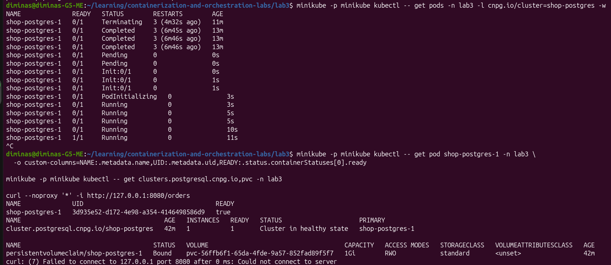

PVC `shop-postgres-1` остался привязан к тому же PV. После восстановления запрос `/orders` вернул HTTP 200 и прежний заказ `cnpg-test` с `processed: true`, поэтому данные пережили замену Pod.

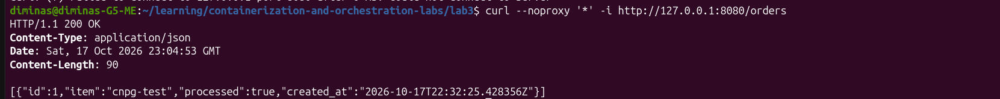

В объекте `Cluster` поле `spec` содержит желаемое состояние: число экземпляров, bootstrap базы, образ, ресурсы и размер хранилища. Поле `status` заполняется оператором и отражает наблюдаемое состояние: текущий primary, готовые экземпляры, здоровый PVC, фазу и условия готовности. После reconciliation в `status` указаны `readyInstances: 1` и `phase: Cluster in healthy state`.

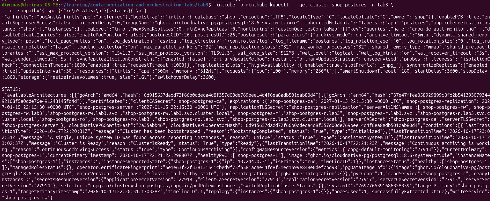

### Отличие оператора от controller-manager

`kube-controller-manager` запускает встроенные контроллеры Kubernetes для универсальных ресурсов: Deployment, ReplicaSet, Node, Job и других. Он знает общие правила управления Kubernetes-объектами, но не понимает внутреннюю семантику PostgreSQL.

CloudNativePG расширяет Kubernetes собственным CRD `Cluster` и отдельным контроллером. Его reconciliation включает предметную логику базы данных: bootstrap PostgreSQL, выбор primary, управление PVC, сервисами и сертификатами, безопасное завершение экземпляра и восстановление после сбоя. Оба компонента используют один цикл `desired state -> observed state -> action`, но оператор добавляет знание конкретного приложения поверх Kubernetes API.

### Нехватка памяти при проверке восстановления

Во время удаления Pod PostgreSQL возникли таймауты API Kubernetes и probes нескольких приложений. У контейнера Minikube был лимит 4 GiB; счётчики cgroup показали многочисленные достижения лимита и сильное давление на память (`memory.pressure full avg10` около 80%), без OOM-kill.

Лимит существующего Docker-контейнера увеличен до 8 GiB RAM и 10 GiB суммарно RAM + swap:

```bash
docker update --memory=8g --memory-swap=10g minikube
```

Попытка изменить память через `minikube start --memory` была отклонена для существующего профиля. Прямой Docker-рестарт потребовал восстановления служб containerd/kubelet и штатной инициализации через `minikube start -p minikube`. После восстановления записи `control-plane.minikube.internal` был перезапущен kube-proxy, который до этого не мог подключиться к API и настроить сервисную сеть. Затем перезапущены Deployment API и worker.

После восстановления подтверждены лимит 8 GiB, готовность API `3/3`, worker `2/2` и PostgreSQL `1/1`. Затем эксперимент с удалением Pod был выполнен повторно на стабильном кластере и завершился успешно, как показано выше. После последующих запусков Minikube фактический лимит следует проверять через `docker stats minikube --no-stream`.


# Часть 4 — Падение control plane

Перед экспериментом зафиксировано исходное состояние: Deployment API готов `3/3`, worker готов `2/2`, Pod PostgreSQL работает. Через ClusterIP из ноды Minikube успешно отвечали `/health` API и worker, а TCP-порт PostgreSQL 5432 был доступен.

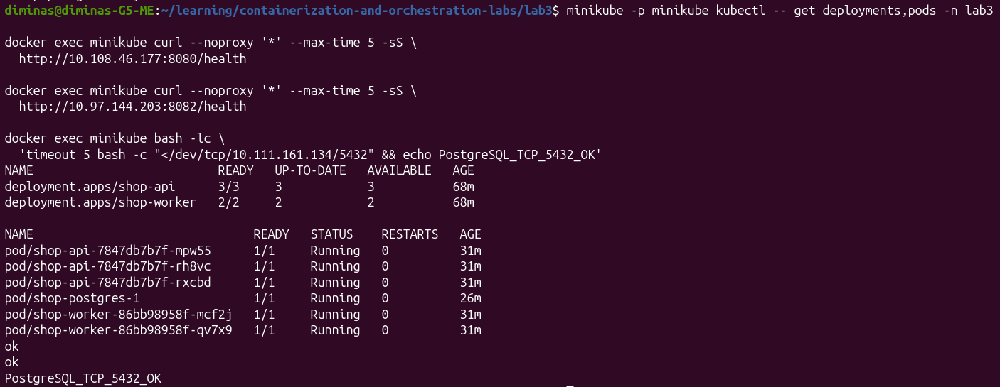

В Minikube API server работает как static Pod, поэтому kubelet автоматически запустил бы его заново после остановки контейнера. Для контролируемого эксперимента сначала был временно остановлен kubelet, затем отправлена команда остановки контейнера `kube-apiserver`. Вызов `crictl stop` завершился по таймауту, однако API server прекратил принимать соединения: попытка изменить число реплик API через `kubectl scale` получила `connection refused` и не записала новое желаемое состояние.

При недоступном API server уже запущенные workload-контейнеры продолжили выполняться под управлением containerd, а существующие правила kube-proxy продолжили маршрутизировать трафик Service. Поэтому API вернул `ok`, `/orders` вернул сохранённый заказ, worker вернул `ok`, а TCP-порт PostgreSQL остался доступен. Control plane был недоступен для чтения и изменений, но существующий dataplane продолжил работу.

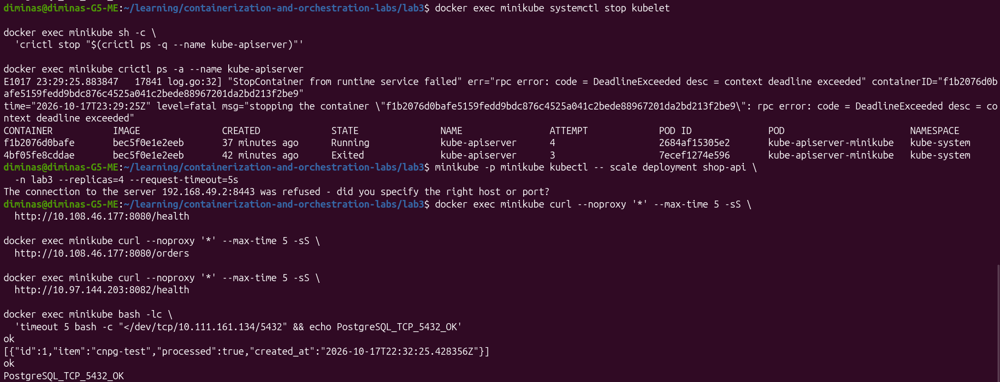

Для восстановления был снова запущен kubelet. Он пересоздал static Pod `kube-apiserver`: номер попытки контейнера изменился с `4` на `5`. После прохождения `/readyz` управление кластером восстановилось. Deployment API остался в состоянии `3/3`, что подтверждает: неудачная команда `scale --replicas=4` не была сохранена. Worker вернулся в состояние `2/2`, а объект PostgreSQL — `Cluster in healthy state` с одним готовым экземпляром.

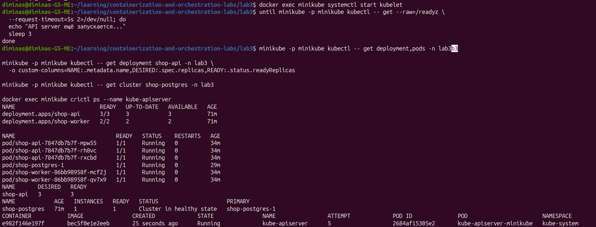

Эксперимент показывает разделение control plane и dataplane. API server нужен для принятия и сохранения нового желаемого состояния, а уже запущенным процессам приложения он не требуется для обработки запросов. При этом без control plane не выполняются новые изменения и reconciliation, требующий обращения контроллеров к Kubernetes API. В данном однодовом Minikube kubelet был остановлен только для предотвращения немедленного перезапуска static Pod API server; containerd и workload-контейнеры продолжали работать.


# Часть 5 — Мониторинг

Использован существующий стек `kube-prometheus-stack` из Лабы 2. Новый Prometheus и Grafana не устанавливались. В API и worker добавлен endpoint `/metrics` в формате Prometheus. API публикует состояние здоровья и число созданных заказов, worker — число обработанных заказов; оба сервиса публикуют информационную метрику `shop_service_info`.

В чарт добавлены `ServiceMonitor`, `PrometheusRule` и ConfigMap дашборда Grafana. Prometheus из Лабы 2 настроен выбирать `ServiceMonitor` только из namespace `lab2`, поэтому объект создаётся там, а через `namespaceSelector` выбирает сервисы в `lab3`. `PrometheusRule` создаётся в `lab3` с меткой `release: monitoring`, которую использует существующий Prometheus.

После обновления чарта готовы три реплики API и две реплики worker, оба endpoint `/metrics` отвечают, а объекты мониторинга созданы.

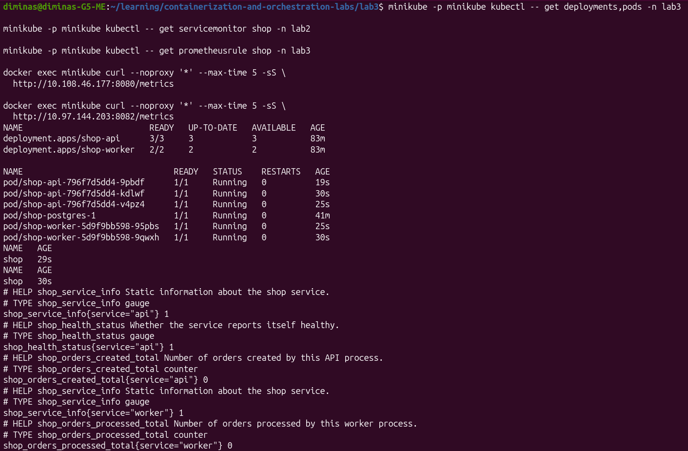

Grafana sidecar загружает dashboard ConfigMap по метке `grafana_dashboard: "1"`. Дашборд показывает количество доступных scrape targets, готовые реплики API и worker, готовность PostgreSQL, а также счётчики созданных и обработанных заказов.

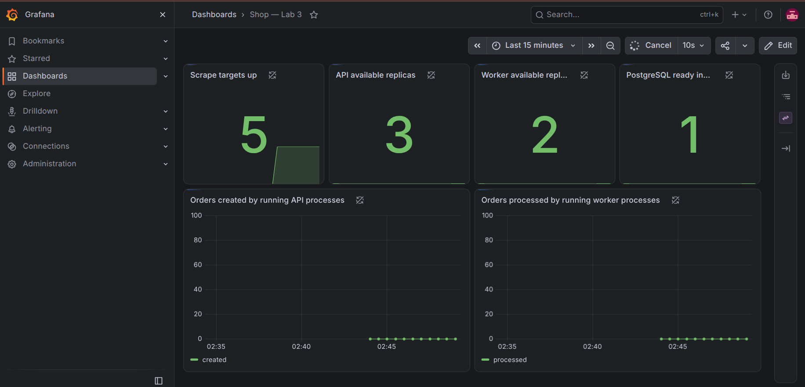

Prometheus обнаружил пять целей через `ServiceMonitor`: три Pod API и два Pod worker. Все цели находятся в состоянии `UP`.

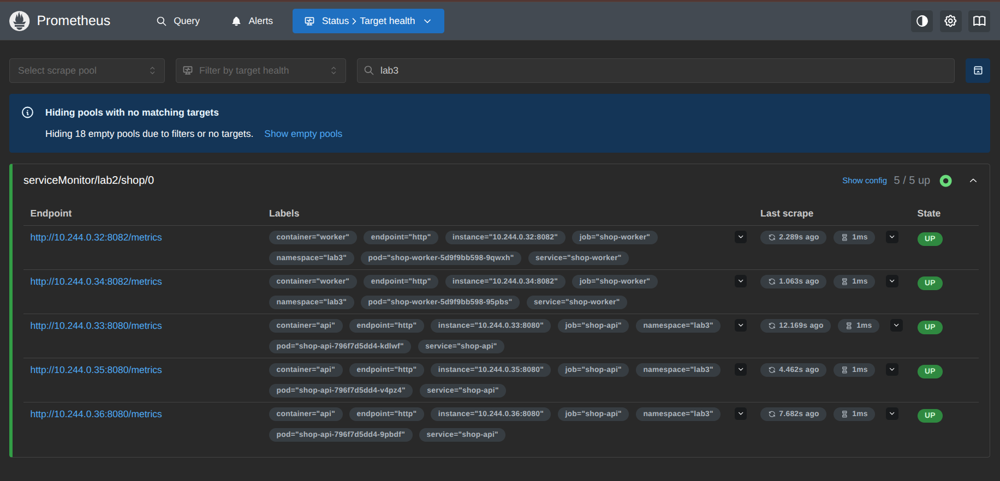

### Алерты

В `PrometheusRule` описаны три правила с выдержкой `for: 1m`, которая отсекает краткие переходные состояния при обычном rollout:

| Алерт | Условие | Обоснование |
| --- | --- | --- |
| `ShopApiInsufficientReplicas` | Готовых реплик API меньше 3 | Потеря реплик уменьшает запас доступности и нарушает рассчитанную ёмкость API; критичность `critical` |
| `ShopWorkerInsufficientReplicas` | Готовых реплик worker меньше 2 | Один worker убирает резервирование обработки заказов и снижает пропускную способность; критичность `warning` |
| `ShopPostgresUnavailable` | Нет ни одного готового Pod PostgreSQL | Без primary недоступны создание, чтение и обработка заказов; критичность `critical` |

Для проверки число реплик worker временно уменьшено с двух до одной через Helm. После обновления метрики и выдержки правила `ShopWorkerInsufficientReplicas` перешёл в состояние `FIRING`, а два остальных правила остались неактивны.

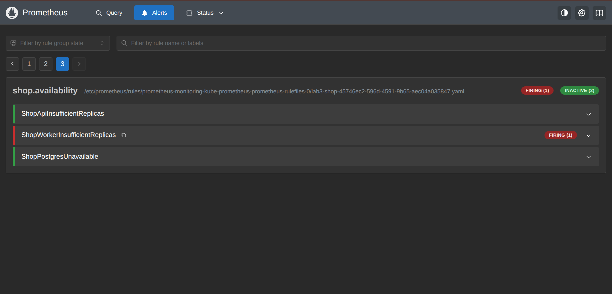

После проверки чарт установлен повторно с параметрами по умолчанию, worker восстановлен до `2/2`. Тестовый алерт разрешается после следующего scrape и цикла вычисления правил.
