# Лабораторная работа 3 — Собери платформу для shop

## Структура проекта

```text
lab3/
├── Dockerfile
├── README.md
├── go.mod
├── go.sum
├── services/
│   ├── api/
│   │   └── main.go
│   └── worker/
│       └── main.go
├── policies/
│   ├── no-latest.yaml
│   ├── no-privileged.yaml
│   ├── require-app-label.yaml
│   ├── require-limits.yaml
│   ├── require-non-root.yaml
│   └── tests/
│       ├── no-app-label.yaml
│       ├── no-limits.yaml
│       ├── latest.yaml
│       ├── privileged.yaml
│       ├── root.yaml
│       └── valid-pod.yaml
│   helm/shop/
│   ├── Chart.yaml
│   ├── values.yaml
│   └── templates/
│       ├── api-deployment.yaml
│       ├── api-service.yaml
│       ├── worker-deployment.yaml
│       └── worker-service.yaml
├── images/
│   ├── part0/
│   ├── part1/
│   ├── part2/
│   ├── part3/
```

---

# Часть 0 — Сервис

### Описание сервисов

| Сервис | Назначение  |
| ----- | ----------- |
| `api`   |  HTTP-сервис для создания и получения заказов   |
| `worker`   | фоновый обработчик, который читает заказы из PostgreSQL и помечает их обработанными |

При запуске автоматически создается таблица `orders` (если она отсутствует), для заказа сохраняются id, название, статус обработки и время создания. Worker раз в две секунды выбирает один необработанный заказ и устанавливает новый статус `processed=true`.

### Проверка создания и обработки заказов

Был создан тестовый заказ, успешно получен HTTP 201 и запись со значением `processed=false`

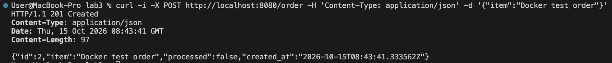

После запуска worker y созданного заказа значение изменилось на `processed=true`. В логах worker появилась запись `order processed` с идентификатором и названием заказа:

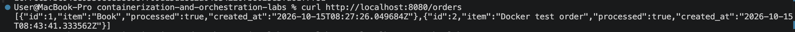

Отдельно проверен запрос `/health` с переменной `HEALTH_FAIL=true`, вернулся HTTP 503 и сообщение `health check failed`. 

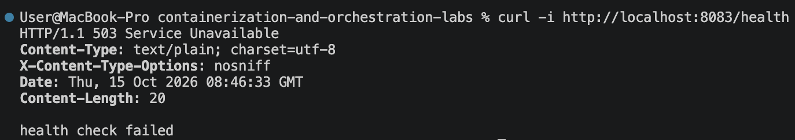

---

# Часть 1 — Ограждения на кластер

### Выбор движка
На выбор были предоставлены 2 движка: Kyverno и OPA / Gatekeeper. В рамках данной лабораторной работы для проверки ресурсов был выбран Kyverno, который позволяет описывать политики в yaml без изучения отдельного языка Rego, используемого OPA/Gatekeeper. Он не потребляет много ресурсов, довольно простой, что идеально для енбольшого локального проекта. Конечно же, если бы речь шла не о лабораторной, а о полноценной корпоративной инфраструктуре, стоило бы задуматься о Gatekeeper :)

### Реализованные правила

Все политики описаны объектами `ClusterPolicy`, из проверки исключены `kube-system`, `kube-public`, `kube-node-lease` и `kyverno`, чтобы ограничения не блокировали работу и восстановление системных компонентов.

| Политика | Проверка | Обоснование |
| --- | --- | --- |
| `require-limits` | У каждого контейнера указаны лимиты CPU и памяти | Ограничивает потребление ресурсов контейнером |
| `require-app-label` | У pod есть непустая метка `app` | Позволяет определить принадлежность pod к приложению и фильтровать ресурсы |
| `no-privileged` | У контейнеров запрещено `privileged: true` | Ограничивает расширенный доступ контейнеров к ресурсам нод |
| `require-non-root` | На уровне pod задано `runAsNonRoot: true`, запрещено явно использовать UID 0 | Снижает риски запуска процессов с правами root |
| `no-latest` | У обычных и init-контейнеров указан явный тег образа, отличный от `latest` | Требует явно указывать используемую версию образа |


### Тестирование

Подготовлены пять тестовых манифестов, каждый из которых нарушает одно правило и соответствует остальным:

| Тестовый файл | Нарушение |
| --- | --- |
| `no-limits.yaml` | Отсутствуют лимиты CPU и памяти |
| `no-app-label.yaml` | Отсутствует метка `app` |
| `privileged.yaml` | Установлено `privileged: true` |
| `root.yaml` | Заданы `runAsNonRoot: false` и `runAsUser: 0` |
| `latest.yaml` | Используется `busybox:latest` |


Результаты запусков тестов:

```bash
minikube -p minikube kubectl -- apply -f policies/tests/no-limits.yaml
```
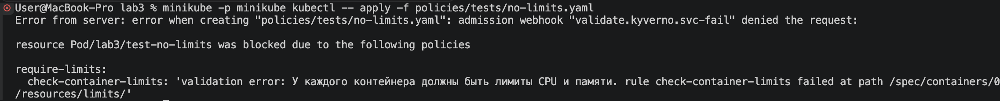

```bash
minikube -p minikube kubectl -- apply -f policies/tests/no-app-label.yaml
```
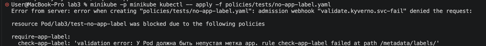

```bash
minikube -p minikube kubectl -- apply -f policies/tests/privileged.yaml
```
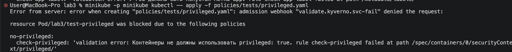

```bash
minikube -p minikube kubectl -- apply -f policies/tests/root.yaml
```
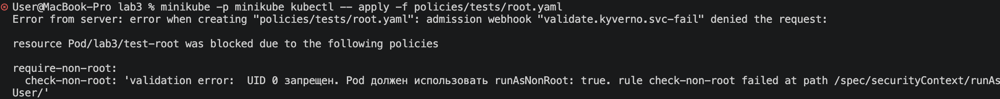

```bash
minikube -p minikube kubectl -- apply -f policies/tests/latest.yaml
```
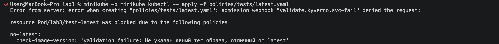


### Проверка корректного pod

Отдельно был собран и проверен полностью соответствующий всем политикам `valid-pod.yaml`, чтобы убедиться, что все тесты успешно отработают:
- указана метка `app`
- заданы лимиты CPU и памяти
- используется образ `busybox:1.37.0`
- включен `runAsNonRoot` и задан UID 65532
- привилегированный режим отключен

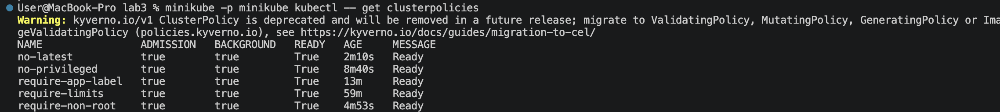


# Часть 2 — Чарт api и worker

Для каждого приложения предусмотрены deployment (управляет количеством реплик и их обновлением) и service (доступ к готовым pod). Основные параметры вынесены в `values.yaml`, а все шаблоны соответствуют политикам из части 1.

### Установка чарта

Перед установкой были проверены структура чарта и манифесты:
```bash
helm lint ./helm/shop
helm template shop ./helm/shop -n lab3
```

В результате были получены три готовые реплики api и две реплики worker:

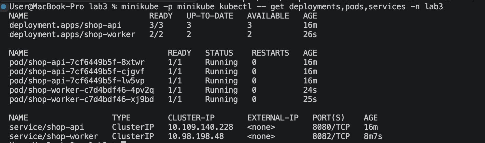


### Проверка чарта

Далее были дернуты запросы для проверки работоспособности. api вернул 200 на проверку здоровья и 201 при создании заказа, а после обработки worker у нового заказа значение `processed` изменилось на `true`.

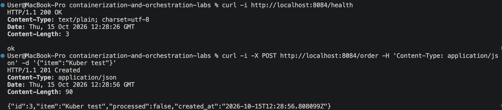
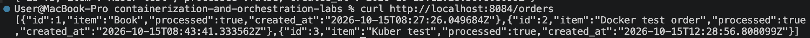


### Проверка reconciliation

Далее вручную был удален один pod и в результате ReplicaSet создал замену с новым именем:

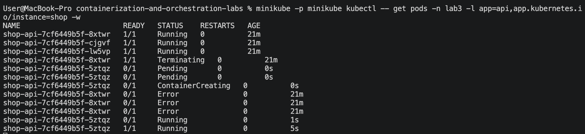

Deployment восстановил состояние `READY 3/3`. Таким образом, удаление отдельного pod не изменяет установленное число реплик благодаря автоматическому созданию замены.

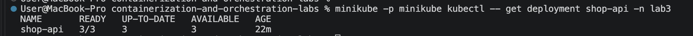

Затем в `values.yaml` было изменено значение `api.replicas` с 3 на 4. Как итог, появилась дополнительная реплика, а deployment достиг состояния `READY 4/4`.

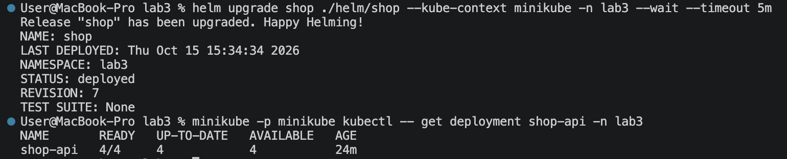

В конце значение возвращено к 3 и повторно выполнено обновление Helm. Число реплик вернулось к `READY 3/3`.

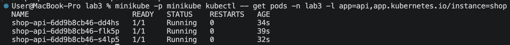


### Проверка rolling update

В код api добавлена отметка версии `v2` в сообщении о запуске, собран и загружен новый образ:

```bash
docker build --target api -t lab3-api:v2 .
minikube -p minikube image load lab3-api:v2
```

Для проверки доступности во время обновления из ноды Minikube запущен цикл запросов к ClusterIP Service `shop-api`. В `values.yaml` тег api заменен на `v2`, после чего выполнен `helm upgrade`. По завершении получились три готовых pod с образом `lab3-api:v2`:

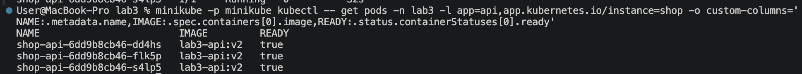


### Проверка со сломанным обновлением

Перед проверкой был выкачен список `helm history` для определения последним успешным релизом:
```bash
helm history shop --kube-context minikube -n lab3
```

А в `values.yaml` установлено:
```yaml
healthFail: true
```

Новый pod начал возвращать 503 на `/health` и не прошел проверку. Обновление было остановлено, три старые исправные реплики продолжили работать, а новая оставалась неготовой:

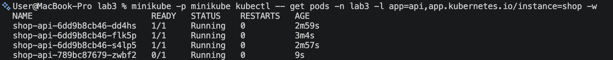


Проверка rollout завершилась ожидаемым таймаутом:

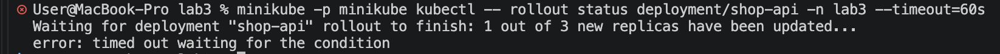


### Helm rollback

Для восстановления выполнен откат на успешную ревизию, выбранную перед проверкой. После отката api вернулся в состояние `3/3`, worker остался в состоянии `2/2`, а в истории helm появилась новая запись.

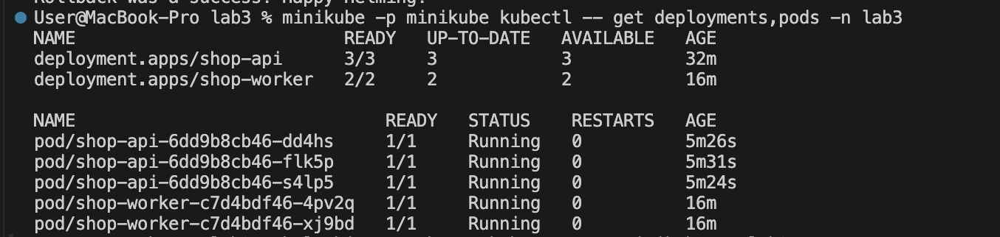

