# Лабораторная работа 4 — SLA критического пути под перегрузкой

## Структура проекта

```text
lab4/
├── README.md
├── lab.md
├── kind.yaml
├── infra/
│   ├── local-path-config.yaml
│   └── local-path-provisioner.yaml
├── policies/
│   └── require-non-root.yaml
├── load/
│   └── orders.js
├── krr/
│   ├── cnpg.py
│   ├── run.sh
│   └── report.json
├── batch/
│   ├── .dockerignore
│   ├── Dockerfile
│   ├── go.mod
│   └── main.go
├── helm/
│   ├── monitoring-values.yaml
│   └── shop/
│       ├── Chart.yaml
│       ├── values.yaml
│       └── templates/
└── images/
    ├── part0/
    ├── part2/
    ├── part3/
    ├── part4/
    └── part5/
```

---

# Часть 0 — Сервис batch

Создан сервис на Go: CPU-воркеры непрерывно вычисляют SHA-256, а отдельный
цикл удерживает выделенный буфер и каждые 200 мс обращается к каждой странице
памяти. Это обеспечивает реальное заполнение страниц и поддерживает их
активность. Процесс завершает работу по SIGINT/SIGTERM.

| Переменная | По умолчанию | Назначение |
| --- | --- | --- |
| `CPU_WORKERS` | `1` | Число CPU-воркеров; фактическое потребление зависит также от доступного CPU и лимитов контейнера |
| `MEMORY_MIB` | `64` | Размер удерживаемого буфера в MiB; полное потребление процесса несколько выше из-за runtime и служебных данных |

Dockerfile собирает статический бинарный файл и помещает его в образ
`scratch`. Процесс запускается от пользователя `65532:65532`.
Параметры нагрузки при развёртывании будут передаваться из values чарта.

### Проверка контейнера

Образ `lab4-batch:v1` собран из каталога `lab4`:

```bash
docker build -t lab4-batch:v1 ./batch
```

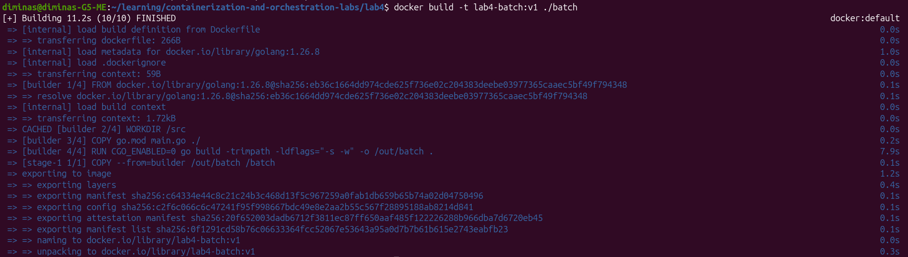

Контейнер запущен с ограничением 0,5 CPU и 192 MiB памяти, одним
CPU-воркером и буфером 64 MiB:

```bash
docker run -d --name lab4-batch-check \
  --cpus=0.5 --memory=192m --memory-swap=192m \
  -e CPU_WORKERS=1 -e MEMORY_MIB=64 lab4-batch:v1
```

При проверке потребление CPU составило `52.33%`, памяти — `66.9 MiB`.
Потребление памяти немного выше размера буфера из-за накладных расходов
процесса. Контейнер работает от пользователя `65532:65532`,
`running=true`, `oomKilled=false`.

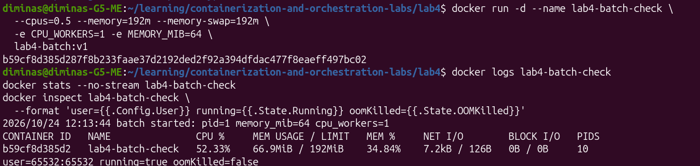

После `docker stop` процесс записал `batch stopped`, затем контейнер удалён:

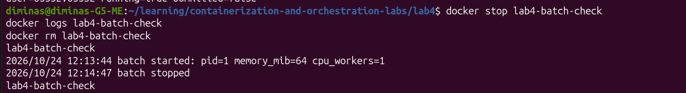

**Результат:** сервис создаёт нагрузку на CPU и память, запускается без root
и корректно завершается по SIGTERM. ✅

---

# Часть 1 — Выбор механизма разнесения

Чарт из лабораторной 3 скопирован в `helm/shop`, чтобы изменения лабораторной 4
хранились отдельно. В `values.yaml` добавлен параметр
`scheduling.mechanism: topologySpreadConstraints`; альтернативное значение —
`podAntiAffinity`. Подключение выбранного механизма к шаблону API выполняется
в части 4; сейчас параметр фиксирует выбор и ещё не меняет размещение Pod.

`podAntiAffinity` описывает нежелательное соседство с подходящими по меткам
Pod в одном топологическом домене. Жёсткое правило на уровне hostname
не позволит разместить две реплики API на одной ноде: при трёх репликах
и двух нодах третья останется Pending. Мягкое правило допускает такое
соседство и не гарантирует разнесение.

`topologySpreadConstraints` ограничивает разницу числа подходящих Pod между
топологическими доменами. Для двух доступных нод при `maxSkew: 1` и
`whenUnsatisfiable: DoNotSchedule` три реплики API могут разместиться как
`2+1`, а две — как `1+1`. Поэтому выбран этот механизм: он обеспечивает
баланс и подходит для тесного кластера с тремя исходными репликами API.
При этом ограничения учитывают доступные домены и остальные условия
планирования; они сами по себе не гарантируют работоспособность при потере
ноды и не переносят уже запущенные Pod автоматически.

**Результат:** выбран `topologySpreadConstraints`, выбор зафиксирован
в `values.yaml`.

Проверка чарта выполнена из каталога `lab4`:

```bash
helm lint ./helm/shop
```

Helm проверил один чарт: `1 chart(s) linted, 0 chart(s) failed`.
Замечание `icon is recommended` носит рекомендательный характер.

---

# Часть 2 — Тесная площадка

### Кластер kind

Создан новый кластер `lab4` на Kubernetes `v1.37.0`: одна control-plane-нода
и одна worker-нода. Конфигурация хранится в `kind.yaml`.
На control-plane снят стандартный taint, чтобы обе ноды могли принимать
поды приложения. Это позволяет в дальнейшем проверить разнесение API,
не выходя за ограничение в две ноды.

Все команды выполняются из каталога `lab4`:

```bash
kind create cluster --name lab4 --config ./kind.yaml --wait 180s
kubectl --context kind-lab4 get nodes -o wide
kubectl --context kind-lab4 get nodes \
  -o custom-columns='NAME:.metadata.name,TAINTS:.spec.taints'
```

При первом запуске kind `0.30.0` из apt создание кластера завершилось ошибкой:
он передал kubeadm конфигурацию `v1beta3`, которую kubeadm `v1.37.0`
уже не принимает. После установки kind `v0.33.0` кластер успешно создан.

Обе ноды находятся в состоянии `Ready`, taints отсутствуют:

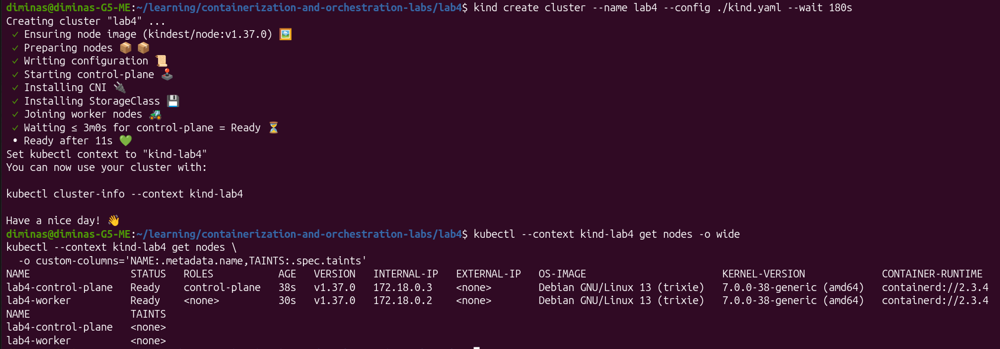

### CloudNativePG

Оператор CloudNativePG установлен отдельным Helm-релизом `cnpg`
в namespace `cnpg-system`. Для оператора заданы requests `100m CPU / 128Mi`
и limits `500m CPU / 256Mi`, а также метка `app: cnpg` для соответствия
политикам лабораторной 3.

Первый запуск был заблокирован загрузкой образа: containerd обращался
к прокси `127.0.0.1:10809`. В сетевом namespace kind-ноды этот адрес указывает
на саму ноду, где прокси отсутствовал, поэтому Pod получил `ImagePullBackOff`.
Прямая проверка `https://ghcr.io/v2/` из ноды вернула `HTTP 401`: registry
доступен и требует авторизации для этого запроса.

На обеих нодах через systemd drop-in
`/etc/systemd/system/containerd.service.d/zz-lab4-direct.conf` очищены
переменные прокси для containerd, затем сервис перезапущен.
После очередной попытки загрузки образа Pod оператора
`ghcr.io/cloudnative-pg/cloudnative-pg:1.30.1` перешёл в `1/1 Running`
без перезапусков. Повторный Helm upgrade до восстановления Pod успел
завершиться ошибкой `Progress deadline exceeded`; фактическую готовность
оператора подтвердили отдельной проверкой Pod.

После восстановления оператора повторный `helm upgrade --reuse-values`
завершился успешно: релиз `cnpg` перешёл в `deployed`, ревизия 3.
Используется чарт `cloudnative-pg-0.29.1`, версия оператора `1.30.1`.

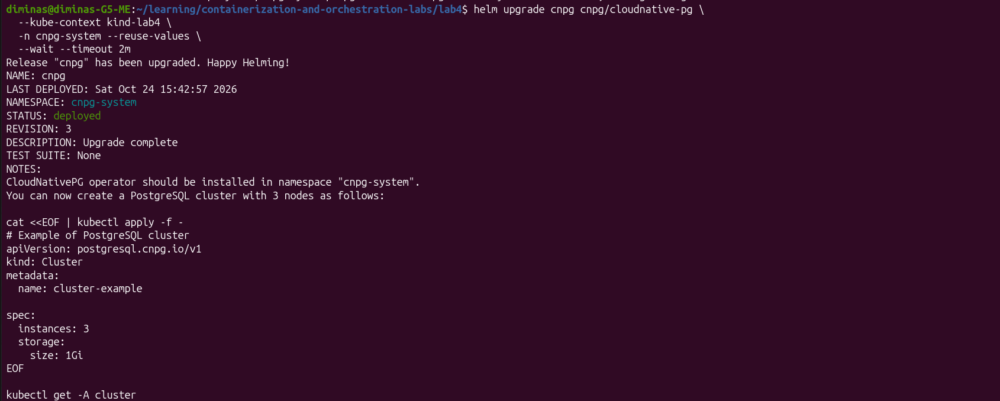

### Kyverno

В namespace `kyverno` установлен чарт `kyverno-3.9.2`, версия Kyverno
`v1.19.2`:

```bash
helm upgrade --install kyverno kyverno/kyverno \
  --kube-context kind-lab4 \
  -n kyverno --create-namespace \
  --wait --timeout 5m
```

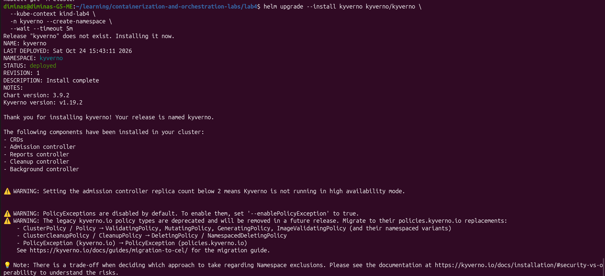

Для учебного кластера используется по одной реплике каждого контроллера.
Это экономит ресурсы тесной площадки, но не обеспечивает HA самого Kyverno.

### Проверка операторов

```bash
kubectl --context kind-lab4 get deployments -n cnpg-system
kubectl --context kind-lab4 get deployments -n kyverno
helm list --kube-context kind-lab4 -A
```

Deployment CloudNativePG и четыре Deployment Kyverno готовы `1/1`.
Оба Helm-релиза находятся в состоянии `deployed`.

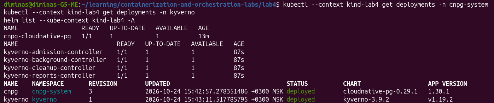

### Ограждения из лабораторной 3

В новый кластер применены исходные политики Kyverno:

```bash
kubectl --context kind-lab4 apply -f ../lab3/policies/
kubectl --context kind-lab4 wait \
  --for=condition=Ready clusterpolicy --all --timeout=120s
kubectl --context kind-lab4 get clusterpolicies
```

Все пять политик готовы (`READY: True`): `no-latest`, `no-privileged`,
`require-app-label`, `require-limits`, `require-non-root`.
Они проверяют явный тег образа, отсутствие privileged, метку `app`,
лимиты CPU/памяти и запуск без root. Для namespace приложения исключения
не добавлялись; batch должен выполнять те же требования.

Kyverno предупреждает об устаревании API `kyverno.io/v1 ClusterPolicy`,
но установленная версия поддерживает его и успешно приняла политики.

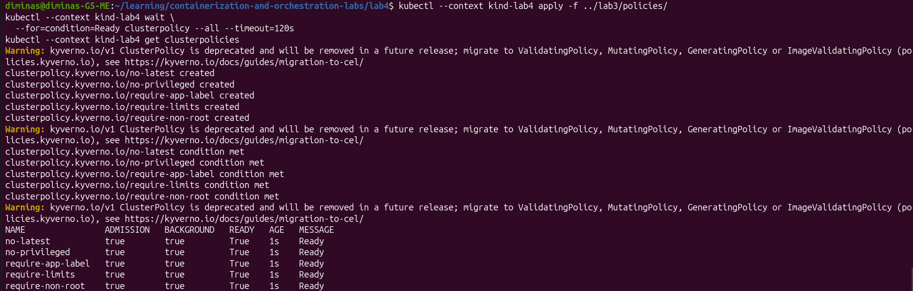

### Мониторинг

В новом kind-кластере установлен стек из лабораторной 2 —
`kube-prometheus-stack` с Prometheus, Grafana, Alertmanager,
kube-state-metrics и node-exporter. Использован исходный файл настроек
лабораторной 2 и дополнительный `helm/monitoring-values.yaml`, который
убирает подключения к отсутствующим в этом кластере Loki и webhook.

```bash
helm upgrade --install monitoring prometheus-community/kube-prometheus-stack \
  --kube-context kind-lab4 \
  -n lab2 --create-namespace \
  -f ../lab2/helm/monitoring-values.yaml \
  -f ./helm/monitoring-values.yaml \
  --wait --timeout 10m
```

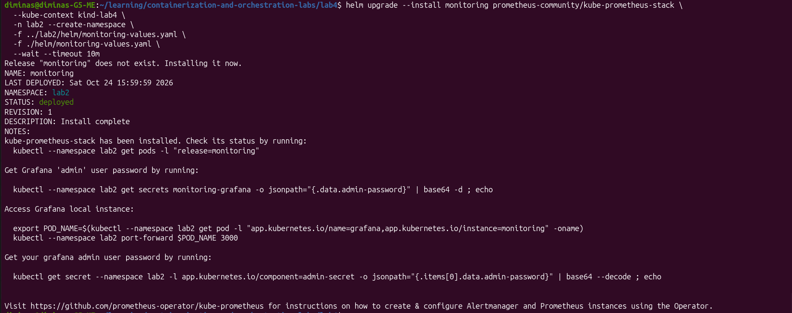

Используется чарт `kube-prometheus-stack-92.12.0`, версия Prometheus Operator
`v0.94.1`. Релиз `monitoring` находится в состоянии `deployed`, все семь Pod
работают и все их контейнеры готовы, перезапусков нет.

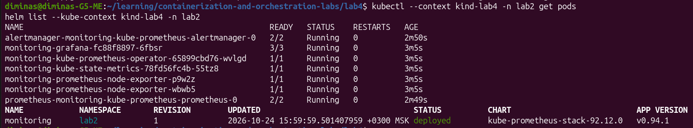

Стек установлен до приложения: унаследованный чарт shop уже создаёт
`ServiceMonitor` и `PrometheusRule`, которым нужны CRD Prometheus Operator.
В части 3 Prometheus будет источником реального потребления ресурсов для krr.

### Диагностика хранилища PostgreSQL

При первом развёртывании shop batch запустился, но PostgreSQL остался
в ожидании PVC, а API и worker перезапускались с `connection refused`
при подключении к базе. В логах local-path-provisioner найден отказ Kyverno:
служебный `helper-pod-create-pvc-*` не соответствовал требованиям метки `app`,
лимитов и non-root. Из-за этого provisioner не мог создать каталог тома.

Для устранения причины подготовлены манифесты:

- `infra/local-path-config.yaml` добавляет helper метку `app: local-path-helper`,
  requests `10m / 16Mi` и limits `100m / 64Mi`;
- `policies/require-non-root.yaml` сохраняет правило лабораторной 3,
  добавляя узкое исключение только для `helper-pod-*` в namespace
  `local-path-storage`. Это системный компонент, которому нужны права
  на создание и удаление каталогов hostPath; для Pod shop исключений нет.
- `infra/local-path-provisioner.yaml` задаёт самому контроллеру хранилища
  non-root UID `65532`, requests `25m / 64Mi` и limits `200m / 128Mi`.
  Его обновление позволяет перезапустить контроллер с соблюдением политик
  и начать новую попытку выделения тома без ожидания прежнего backoff.

Изменённые ConfigMap helper и политика non-root успешно применены.

После применения `infra/local-path-provisioner.yaml` новый Pod контроллера
запустился `1/1 Running`. В логах зафиксированы создание каталога тома
и `ProvisioningSucceeded`. PVC `shop-postgres-1` перешёл в `Bound`,
выделен том `1Gi` с режимом `RWO` и StorageClass `standard`.
CloudNativePG завершил initdb: Pod `shop-postgres-1` готов `1/1`,
кластер PostgreSQL находится в состоянии `Cluster in healthy state`.

Готовность далее проверяется отдельно от Helm, без длительного `--wait`.

### Развёртывание shop и batch

В чарт `helm/shop` добавлен Deployment `batch`. Число реплик, образ,
число CPU-воркеров, размер буфера памяти и requests/limits задаются
в `values.yaml`. Для первой проверки используется одна реплика с одним
CPU-воркером и буфером 64 MiB, requests `100m / 96Mi`, limits `500m / 192Mi`.
Процесс работает от UID `65532`, без повышения привилегий,
со сброшенными capabilities и файловой системой контейнера только для чтения.

API и worker собраны из исходников лабораторной 3. Образы
`lab3-api:v3`, `lab3-worker:v2`, `lab4-batch:v1` загружены в ноды через
`kind load docker-image --name lab4`. Приложение развёрнуто через Helm:

```bash
helm upgrade --install shop ./helm/shop \
  --kube-context kind-lab4 -n lab4 --create-namespace
```

После исправления хранилища выполнен повторный `helm upgrade`:
релиз `shop` находится в состоянии `deployed`, ревизия 2.
Проверка фактического состояния подтвердила:

| Компонент | Готовность |
| --- | --- |
| API | `3/3` |
| worker | `2/2` |
| batch | `1/1` |
| PostgreSQL | `1/1`, `Cluster in healthy state` |
| PVC PostgreSQL | `Bound`, `1Gi`, `RWO` |

API и worker восстановились автоматически после очередной попытки запуска
в CrashLoopBackOff. По 12 перезапусков относятся к периоду недоступности
PostgreSQL во время первоначального развёртывания.

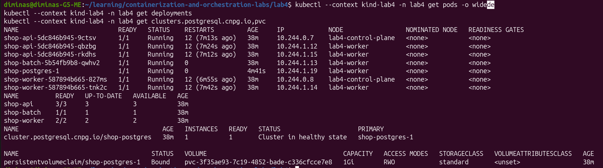

**Результат:** shop и batch работают в kind-кластере строго на двух нодах.
Batch развёрнут через чарт с requests/limits и соблюдением политик приложения. ✅

---

# Часть 3 — Реальные числа вместо угадывания

### Исходные ресурсы

До анализа krr используются следующие значения из `values.yaml`:

| Компонент | CPU request | CPU limit | Memory request | Memory limit |
| --- | --- | --- | --- | --- |
| API | `50m` | `200m` | `32Mi` | `128Mi` |
| worker | `50m` | `200m` | `32Mi` | `128Mi` |
| PostgreSQL | `100m` | `500m` | `256Mi` | `512Mi` |
| batch | `100m` | `500m` | `96Mi` | `192Mi` |

### Сценарий нагрузки

Подготовлен `load/orders.js` для k6: создание заказов через `POST /order`
с ожидаемым ответом `201`. Этот запрос выполняет INSERT в PostgreSQL,
поэтому нагружается критический путь `api → postgres`.
По умолчанию сценарий задаёт 20 запросов в секунду на протяжении 5 минут.
Фиксированная интенсивность позволяет заметить отставание сервиса:
если генератор не успевает начать запланированные итерации,
проверка `dropped_iterations` завершится ошибкой.

Перед нагрузкой проверен запрос `POST /order`: получен `HTTP 201 Created`
и создан заказ `lab4-baseline-check` с идентификатором `1`.

Генератор k6 запущен отдельным Docker-контейнером в сетевом namespace
ноды `lab4-worker`. Запросы идут на ClusterIP Service `shop-api`,
чтобы использовать балансировку между репликами API. Нагрузка генератора
не размещается отдельным Pod в тесном кластере.

### Исходный замер

Выполнен пятиминутный прогон k6 `2.3.0` с интенсивностью 20 запросов/с:

| Показатель | Результат |
| --- | --- |
| Создано заказов | `6000` |
| Ответы `201` | `100%` |
| Ошибки HTTP | `0%` |
| Пропущенные итерации | `0` |
| Средняя задержка HTTP | `6.32 ms` |
| p95 задержки HTTP | `9.04 ms` |
| Максимальная задержка HTTP | `514.63 ms` |

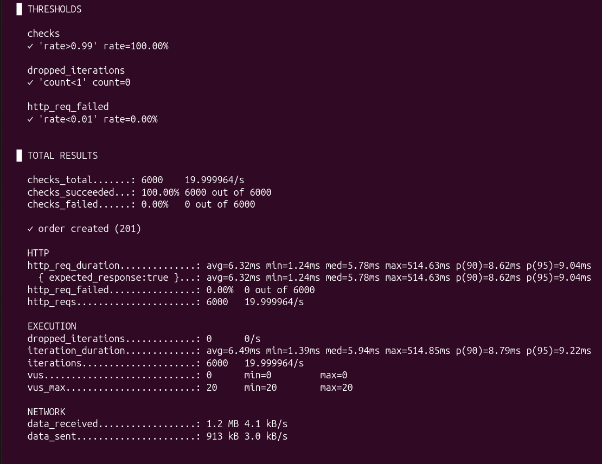

Этот замер фиксирует исходное поведение приложения с одной репликой batch.
Подтверждение SLA при preemption и давлении по памяти выполняется в части 8.

### Получение рекомендаций krr

Использован официальный образ
`us-central1-docker.pkg.dev/genuine-flight-317411/devel/krr:v1.30.0`.
Штатный discovery krr не поддерживает CloudNativePG Cluster:
оператор управляет Pod напрямую, а не через StatefulSet
([issue krr #538](https://github.com/robusta-dev/krr/issues/538)).
Поэтому `krr/cnpg.py` добавляет обнаружение настоящих CNPG Cluster
через Kubernetes API, проверяя owner UID их работающих PostgreSQL-подов.
В отчёте база отображается как `Cluster/shop-postgres`, контейнер `postgres`.
Сбор метрик из Prometheus, стратегия `simple`, округление и минимальные
значения остаются штатными механизмами krr. Адаптер также сохраняет
структурированный JSON того же расчёта, который выводится таблицей.

```bash
bash ./krr/run.sh
```

Скрипт использует сетевой namespace kind-ноды для доступа к Prometheus,
временный внутренний kubeconfig удаляется после завершения.
В Kubernetes выполняются только операции чтения.
Результат сохранён в [krr/report.json](krr/report.json).

Для короткого лабораторного эксперимента заданы окно анализа 1 час,
шаг 1 минута и минимум 10 точек вместо стандартных 100.
Стратегия использует p95 CPU и максимум памяти с запасом 15%,
с учётом минимальных рекомендаций krr: 10m CPU и 100Mi памяти.
Предупреждение `Not enough history available` сохранено в отчёте:
набор данных короче рекомендуемых стратегией трёх часов.
Числовые рекомендации для всех четырёх компонентов получены;
они относятся к этому учебному профилю нагрузки.

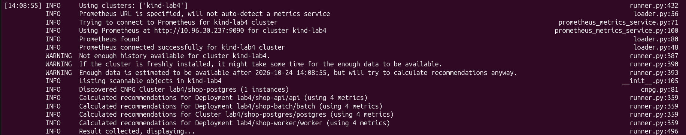

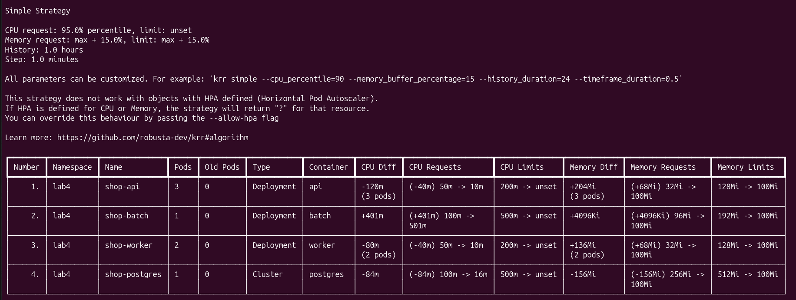

| Компонент | CPU request до → krr | Memory request до → krr | Memory limit krr |
| --- | --- | --- | --- |
| API | `50m → 10m` | `32Mi → 100Mi` | `100Mi` |
| worker | `50m → 10m` | `32Mi → 100Mi` | `100Mi` |
| PostgreSQL | `100m → 16m` | `256Mi → 100Mi` | `100Mi` |
| batch | `100m → 501m` | `96Mi → 100Mi` | `100Mi` |

При 20 заказах/с сервисы критического пути расходуют меньше CPU,
чем предполагалось изначально. Batch, наоборот, непрерывно нагружает CPU
и достигает примерно 0,5 ядра — своего установленного лимита.
Значение рекомендации batch `501m` получилось после округления наблюдений,
оно не доказывает устойчивого превышения CPU-квоты.
Рост рекомендации памяти API и worker до 100Mi связан также с минимальным
порогом krr: это не означает фактическое потребление ими 100Mi.

### Перенос рекомендаций в values

В `helm/shop/values.yaml` перенесены CPU requests и requests/limits памяти
API, worker и PostgreSQL. Стратегия `simple` рекомендует убрать CPU limit
(`unset`), что несовместимо с ограждениями лабораторной. Поэтому на этом
этапе сохранены прежние конечные CPU limits: `200m` для API и worker,
`500m` для PostgreSQL. Эти CPU limits не являются рекомендациями krr.
Исходный JSON-отчёт сохранён без изменения рекомендаций.
В части 5 CPU limits критического пути будут приравнены к CPU requests,
полученным от krr, для выполнения требования Guaranteed.

| Компонент | CPU request | CPU limit | Memory request | Memory limit |
| --- | --- | --- | --- | --- |
| API | `10m` | `200m` | `100Mi` | `100Mi` |
| worker | `10m` | `200m` | `100Mi` | `100Mi` |
| PostgreSQL | `16m` | `500m` | `100Mi` | `100Mi` |

Ресурсы batch сохранены: они задают условия экспериментальной нагрузки,
а требование части 3 касается подбора ресурсов API, worker и PostgreSQL.
У всех контейнеров по-прежнему есть лимиты CPU и памяти.

Команда обновления из каталога `lab4`:

```bash
helm upgrade shop ./helm/shop --kube-context kind-lab4 -n lab4
```

Обновление создало ревизию 3 релиза `shop`. Изменение ресурсов PostgreSQL
потребовало перезапуска единственного экземпляра базы. CNPG сначала
запросил smart shutdown и ждал закрытия соединений до 180 секунд.
На время остановки базы новые API и worker завершались с
`connection refused`, затем восстановились при очередной попытке запуска.

Промежуточная проверка показывала API `READY 3/3` и worker `READY 2/2`,
но `UP-TO-DATE 1` у обоих Deployment: готовность обеспечивали старые Pod.
Кроме того, `/health` проверяет процесс API, а не доступность PostgreSQL,
поэтому такая готовность сама по себе не подтверждает работу пути заказа.

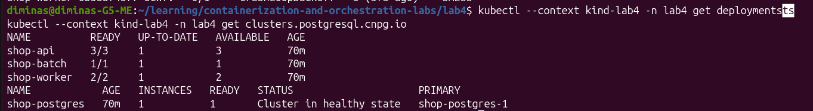

После завершения rollout отдельно проверены текущие ресурсы всех Pod:
у трёх API — `10m / 200m CPU`, `100Mi / 100Mi` памяти;
у двух worker — такие же значения;
у PostgreSQL — `16m / 500m CPU`, `100Mi / 100Mi` памяти
(в каждой паре requests / limits).
API имеет `READY 3/3`, `UP-TO-DATE 3`, worker — `READY 2/2`, `UP-TO-DATE 2`.
PostgreSQL вернулся в `Cluster in healthy state`.

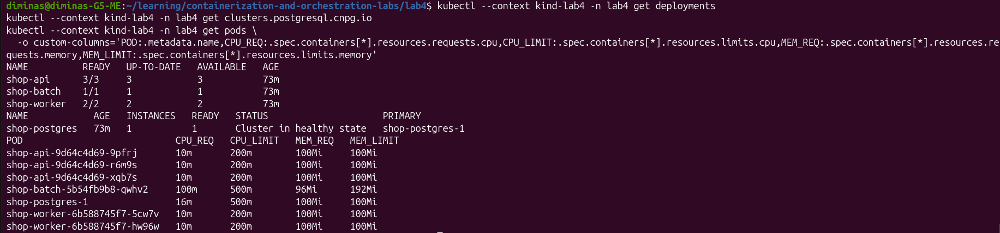

**Результат:** рекомендации krr для API, worker и PostgreSQL перенесены
в values и применены через Helm; rollout завершён. ✅

---

# Часть 4 — Разнесение критического сервиса

В шаблон Deployment API добавлен выбор механизма размещения через
`scheduling.mechanism`. Ветка `topologySpreadConstraints` использует
следующие параметры `values.yaml`:

```yaml
scheduling:
  mechanism: topologySpreadConstraints
  topologyKey: kubernetes.io/hostname
  topologySpread:
    maxSkew: 1
    minDomains: 2
    whenUnsatisfiable: DoNotSchedule
    matchLabelKeys:
      - pod-template-hash
```

Топологический домен — отдельная нода. При двух доступных нодах разница
числа реплик не должна превышать одну: для трёх реплик ожидается `2+1`.
`DoNotSchedule` запрещает новые размещения, нарушающие ограничение.
`minDomains: 2` задаёт минимум двух доступных доменов для обычного расчёта
баланса: если их меньше, глобальный минимум принимается равным нулю.
Это не создаёт недостающую ноду и может оставлять новые Pod в Pending.

Селектор учитывает `app: api` и имя Helm-релиза, поэтому worker, batch
и поды другого релиза не участвуют в подсчёте. `pod-template-hash`
позволяет считать баланс каждой ревизии Deployment отдельно во время
обновления, когда одновременно существуют старые и новые Pod
([документация Kubernetes](https://kubernetes.io/docs/concepts/scheduling-eviction/topology-spread-constraints/)).

Альтернативная ветка `podAntiAffinity` использует жёсткое правило
`requiredDuringSchedulingIgnoredDuringExecution` на том же topologyKey.
При трёх репликах и двух нодах она оставит третью реплику Pending,
что объясняет выбор topology spread для этой площадки.
Неизвестное значение `scheduling.mechanism` останавливает рендеринг чарта.

Разнесение снижает риск одновременной потери всех реплик API при отказе
одной ноды. Оно не устраняет единую точку отказа PostgreSQL:
в этой лабораторной у базы один экземпляр и локальный том.
Доступность всего пути заказа нельзя вывести только из размещения API.

Применение правила выполняется через Helm:

```bash
helm upgrade shop ./helm/shop --kube-context kind-lab4 -n lab4
```

После обновления Deployment API готов `3/3`, `UP-TO-DATE 3`.
Две реплики размещены на `lab4-control-plane`, одна — на `lab4-worker`.
Все три Pod работают без перезапусков.

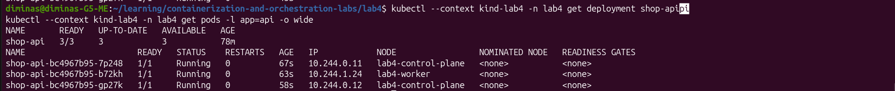

**Результат:** выбранный механизм применён через чарт, распределение `2+1`
подтверждено `kubectl get pods -o wide`. ✅

---

# Часть 5 — Приоритеты и гарантии

### QoS и приоритеты

В чарт добавлен шаблон `priority-class.yaml`. Значения приоритетов,
политика preemption и выбор класса для сервисов задаются в `values.yaml`.
Классы не являются глобальными по умолчанию.

| Компонент | PriorityClass | Приоритет | CPU requests = limits | Память requests = limits | Целевой QoS |
| --- | --- | --- | --- | --- | --- |
| API | `shop-critical` | `100000` | `10m` | `100Mi` | Guaranteed |
| PostgreSQL | `shop-critical` | `100000` | `16m` | `100Mi` | Guaranteed |

Числа requests взяты из krr части 3. Для Guaranteed CPU limits приравнены
к этим requests, а не удалены, как предлагает стратегия `simple`.
Равенство выполняется для CPU и памяти у всех контейнеров Pod.
Проверка существующего Pod CNPG показала, что `bootstrap-controller`
получает те же ресурсы, что и основной контейнер PostgreSQL.
Фактический QoS после обновления проверяется через `.status.qosClass`.

После Helm upgrade все три новые реплики API и PostgreSQL получили
`Guaranteed`, класс `shop-critical` и приоритет `100000`.
Batch получил `Burstable`, `shop-batch`, `-1000`.
Оба worker остались `Burstable` с приоритетом `0`.
Deployment API готов `3/3` и полностью обновлён; batch — `1/1`, worker — `2/2`.

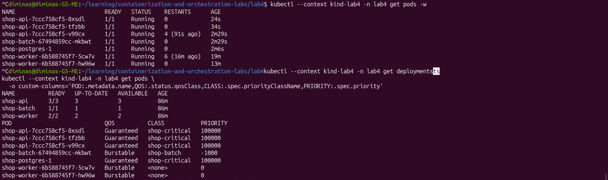

Batch получает `shop-batch` с приоритетом `-1000` и остаётся Burstable:
requests `100m / 96Mi` заметно ниже limits `500m / 192Mi`.
Worker сохраняет приоритет по умолчанию `0` и Burstable.
Политика классов `PreemptLowerPriority` позволяет планировщику освобождать
место для нового высокоприоритетного Pod за счёт более низких приоритетов.
Сам по себе уже работающий высокий приоритет не запускает preemption.

Приоритет и QoS решают разные задачи. Scheduler выбирает жертв preemption
по приоритету и возможности разместить ожидающий Pod; QoS не является
критерием этого выбора. При давлении по памяти kubelet сначала учитывает,
превышает ли потребление requests, затем приоритет, затем величину
потребления относительно requests. Поэтому Burstable batch, превышающий
memory request и имеющий низкий приоритет, менее защищён, чем критический
Guaranteed Pod. Одного названия Burstable недостаточно, чтобы гарантировать
порядок жертв: это нужно проверить при фактическом давлении в части 7.
Guaranteed также не отменяет собственный memory limit и CPU throttling
([приоритеты](https://kubernetes.io/docs/concepts/scheduling-eviction/pod-priority-preemption/),
[node-pressure eviction](https://kubernetes.io/docs/concepts/scheduling-eviction/node-pressure-eviction/)).

### PodDisruptionBudget

В `pod-disruption-budget.yaml` добавлены бюджеты:

| PDB | minAvailable | Смысл |
| --- | --- | --- |
| `shop-api` | `2` | При штатном обслуживании через Eviction API сохраняются минимум две доступные реплики API |
| `shop-postgres-critical` | `1` | Единственный primary нельзя добровольно выселить через Eviction API |

Автоматический PDB CloudNativePG отключён через
`postgres.operatorPDBEnabled: false` → `Cluster.spec.enablePDB: false`.
Вместо него чарт создаёт собственный PDB с селектором primary, чтобы один
Pod не попадал одновременно под два разных бюджета.

Первая проверка обнаружила только `shop-api`. Первоначальное имя PDB базы
`shop-postgres` совпало с именем бюджета реплик, которое резервирует CNPG.
Даже при `enablePDB: false` оператор выполняет очистку своих стандартных
имён. Поэтому имя PDB чарта изменено на `shop-postgres-critical`
([имена PDB в исходниках CNPG](https://github.com/cloudnative-pg/cloudnative-pg/blob/release-1.30/pkg/specs/poddisruptionbudget.go)).

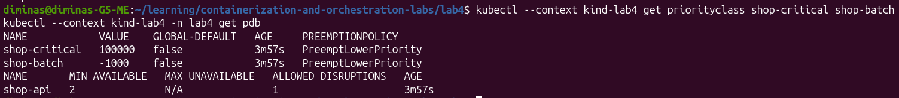

PDB ограничивает добровольные disruptions через Eviction API. Он не
защищает от отказа ноды, OOM и node-pressure eviction, не запрещает прямое
удаление Pod контроллером при rollout. Для scheduler preemption соблюдение
PDB является best effort, а не абсолютным запретом.

### Штатная остановка PostgreSQL

Для локального эксперимента в values заданы `smartShutdownTimeout: 10`
и `stopDelay: 60` секунд. Они передаются в CNPG Cluster через чарт:
сначала PostgreSQL может дождаться закрытия соединений, затем оператор
использует штатный fast shutdown. Это сокращает ожидание открытых
соединений при последующих обновлениях вместо прежнего окна 180 секунд.
Сокращение окна относится к этой учебной базе.

```bash
helm upgrade shop ./helm/shop --kube-context kind-lab4 -n lab4
```
