# Лабораторная работа 4 — SLA критического пути под перегрузкой

В этой работе я проверял, можно ли сохранить оформление заказов, когда
ресурсов в кластере уже не хватает. Критический путь здесь — `api → postgres`,
а batch создаёт фоновую нагрузку, которой можно пожертвовать.

По ходу работы всё несколько раз ломалось: сначала загрузка образов и
хранилище, затем PostgreSQL, а под конец ещё и Grafana. Ниже оставил и удачные
проверки, и неудачные попытки. Иначе из отчёта было бы совершенно непонятно,
почему настройки пришлось менять столько раз.

## Что лежит в lab4

```text
lab4/
├── README.md                 # Ход работы, результаты и скриншоты
├── lab.md                    # Задание
├── kind.yaml                 # Две ноды kind
├── batch/                    # Подопытный сервис на Go и Dockerfile
├── infra/                    # Local-path storage и настройка eviction
├── policies/                 # Настройка non-root для инфраструктуры
├── helm/
│   ├── shop/                 # Чарт приложения
│   ├── monitoring-values.yaml
│   ├── calibration-values.yaml
│   ├── memory-baseline-values.yaml
│   └── memory-pressure-values.yaml
├── krr/                      # Запуск krr, адаптер CNPG и JSON-отчёты
├── load/                     # Сценарий k6, результаты и построение графиков
└── images/                   # Скриншоты и графики по частям работы
```

Все команды ниже я выполнял из каталога `lab4`, если отдельно не указано другое.

---

# Часть 0 — Сервис batch

Для нагрузки сделал небольшой сервис на Go. CPU-воркеры без остановки
вычисляют SHA-256, а отдельный цикл удерживает буфер памяти и каждые 200 мс
трогает каждую его страницу. Одного выделения виртуальной памяти здесь мало:
нужно, чтобы страницы действительно занимали RAM. По SIGINT/SIGTERM сервис
останавливает воркеры и завершает работу.

| Переменная | По умолчанию | Что меняет |
| --- | --- | --- |
| `CPU_WORKERS` | `1` | Число CPU-воркеров; реальный расход CPU также зависит от лимита |
| `MEMORY_MIB` | `64` | Размер буфера; сам процесс занимает немного больше из-за runtime |

В Dockerfile собирается статический бинарник для образа `scratch`.
Контейнер запускается от `65532:65532`, без root.

## Проверка контейнера

Сначала собрал образ:

```bash
docker build -t lab4-batch:v1 ./batch
```


Затем запустил его с одним воркером, буфером 64 MiB, ограничением 0,5 CPU
и лимитом памяти 192 MiB:

```bash
docker run -d --name lab4-batch-check \
  --cpus=0.5 --memory=192m --memory-swap=192m \
  -e CPU_WORKERS=1 -e MEMORY_MIB=64 lab4-batch:v1
```

Получилось `52.33%` CPU и `66.9 MiB` памяти. Небольшая прибавка к размеру
буфера ожидаема: кроме него есть ещё сам процесс. Проверка пользователя
показала `65532:65532`, состояние — `running=true`, `oomKilled=false`.


После `docker stop` в логах появился `batch stopped`. Контейнер удалил.


Сервис делает то, что нужно для следующих опытов: нагружает CPU и память,
работает без root и нормально останавливается.

---

# Часть 1 — Как разнести реплики

Взял чарт из лабы 3 и скопировал в `helm/shop`. Переключатель механизма
размещения добавил в values: `scheduling.mechanism` принимает
`topologySpreadConstraints` или `podAntiAffinity`.

Выбрал `topologySpreadConstraints`. Причина простая: у меня две ноды и три
исходные реплики API. Жёсткий `podAntiAffinity` по hostname запрещает двум
репликам оказаться вместе, поэтому третья останется Pending. Мягкое правило
это разрешит, но уже не гарантирует разнесение.

Topology spread ограничивает разницу в количестве Pod между нодами.
С `maxSkew: 1` и `DoNotSchedule` три реплики можно разместить как `2+1`,
а две — как `1+1`. Для моего маленького кластера это подходит лучше.
При этом правило не переносит уже работающие Pod автоматически и само
по себе не делает приложение устойчивым к любому отказу.

На этом шаге я только добавил выбор в values. Подключение к API — в части 4.
Чарт проверил командой:

```bash
helm lint ./helm/shop
```

Результат: `1 chart(s) linted, 0 chart(s) failed`. Сообщение
`icon is recommended` — рекомендация, а не ошибка.

---

# Часть 2 — Две ноды и первые неприятности

## Кластер kind

Поднял кластер `lab4` на Kubernetes `v1.37.0`: одна control-plane и один worker.
На control-plane убрал стандартный taint, чтобы приложение могло использовать
обе ноды. Конфигурация лежит в `kind.yaml`.

```bash
kind create cluster --name lab4 --config ./kind.yaml --wait 180s
kubectl --context kind-lab4 get nodes -o wide
kubectl --context kind-lab4 get nodes \
  -o custom-columns='NAME:.metadata.name,TAINTS:.spec.taints'
```

Без первого сбоя не обошлось даже здесь. Kind `0.30.0` из apt передал kubeadm
конфигурацию `v1beta3`, которую kubeadm `v1.37.0` уже не принимает.
После установки kind `v0.33.0` кластер создался: обе ноды `Ready`, taints нет.


## CloudNativePG и прокси внутри ноды

Оператор CloudNativePG установил релизом `cnpg` в `cnpg-system`.
Для него задал requests `100m / 128Mi`, limits `500m / 256Mi` и метку
`app: cnpg`, чтобы он проходил политики из лабы 3.

Дальше установка просто застряла на загрузке образа. Containerd пытался
использовать прокси `127.0.0.1:10809`. Только внутри kind-ноды это адрес самой
ноды, а прокси там нет. В результате — `ImagePullBackOff` и несколько
неудачных ожиданий Helm. Прямой запрос к GHCR вернул `HTTP 401`: до registry
достучаться можно, проблема именно в настройках прокси.

На обеих нодах добавил systemd drop-in
`/etc/systemd/system/containerd.service.d/zz-lab4-direct.conf`, очистил
proxy-переменные containerd и перезапустил сервис. После этого образ
`ghcr.io/cloudnative-pg/cloudnative-pg:1.30.1` наконец загрузился.
Оператор стал `1/1 Running` без перезапусков.

Повторный `helm upgrade --reuse-values` завершился успешно:
`deployed`, ревизия 3, чарт `cloudnative-pg-0.29.1`, оператор `1.30.1`.


## Kyverno и политики

Kyverno установил отдельным релизом:

```bash
helm upgrade --install kyverno kyverno/kyverno \
  --kube-context kind-lab4 \
  -n kyverno --create-namespace \
  --wait --timeout 5m
```

Получились чарт `kyverno-3.9.2` и Kyverno `v1.19.2`.


У каждого контроллера оставил по одной реплике. Для учебной площадки это
экономнее, хотя высокой доступности самого Kyverno здесь нет.
Проверил оба оператора и Helm-релизы:

```bash
kubectl --context kind-lab4 get deployments -n cnpg-system
kubectl --context kind-lab4 get deployments -n kyverno
helm list --kube-context kind-lab4 -A
```

CloudNativePG и все четыре Deployment Kyverno готовы `1/1`, релизы — `deployed`.


Применил политики из предыдущей лабы:

```bash
kubectl --context kind-lab4 apply -f ../lab3/policies/
kubectl --context kind-lab4 wait \
  --for=condition=Ready clusterpolicy --all --timeout=120s
kubectl --context kind-lab4 get clusterpolicies
```

Все пять готовы: `no-latest`, `no-privileged`, `require-app-label`,
`require-limits`, `require-non-root`. Они проверяют тег образа, запрет privileged,
метку `app`, лимиты CPU/памяти и запуск без root. Для приложения исключений нет,
batch подчиняется тем же правилам.

Kyverno предупредил, что `kyverno.io/v1 ClusterPolicy` устаревает,
но политики принял и перевёл в `READY: True`.


## Мониторинг

Стек взял из лабы 2: Prometheus, Grafana, Alertmanager, kube-state-metrics
и node-exporter. В `helm/monitoring-values.yaml` убрал подключения к Loki
и webhook, которых в новом кластере нет.

```bash
helm upgrade --install monitoring prometheus-community/kube-prometheus-stack \
  --kube-context kind-lab4 \
  -n lab2 --create-namespace \
  -f ../lab2/helm/monitoring-values.yaml \
  -f ./helm/monitoring-values.yaml \
  --wait --timeout 10m
```


Установка прошла: чарт `kube-prometheus-stack-92.12.0`, Prometheus Operator
`v0.94.1`, релиз `deployed`. Все семь Pod готовы, перезапусков нет.


Мониторинг поставил раньше shop: чарт приложения уже содержит ServiceMonitor
и PrometheusRule, а для них нужны CRD Prometheus Operator. Заодно Prometheus
будет собирать данные для krr.

## Почему PostgreSQL не получал диск

Казалось бы, операторы готовы — можно запускать приложение. Но тут начался
следующий круг: batch работает, PostgreSQL ждёт PVC, API и worker падают
с `connection refused`. Базы просто ещё нет.

В логах local-path-provisioner нашёл причину: Kyverno блокировал служебный
`helper-pod-create-pvc-*`. У него не было нужной метки, лимитов и non-root.
Без helper provisioner не мог создать каталог тома.

Исправления оставил в отдельных файлах:

- `infra/local-path-config.yaml`: метка `app: local-path-helper`, requests
  `10m / 16Mi`, limits `100m / 64Mi` для helper.
- `policies/require-non-root.yaml`: узкое исключение для `helper-pod-*`
  в `local-path-storage`. Helper нужны права на каталоги hostPath;
  для Pod приложения правило остаётся строгим.
- `infra/local-path-provisioner.yaml`: сам контроллер работает от UID `65532`,
  requests `25m / 64Mi`, limits `200m / 128Mi`. После обновления он сразу
  повторил выделение тома, без ожидания старого backoff.

После этого наконец появился `ProvisioningSucceeded`. PVC `shop-postgres-1`
стал `Bound`: `1Gi`, `RWO`, StorageClass `standard`. CNPG закончил initdb,
PostgreSQL стал `1/1` и вернулся в `Cluster in healthy state`.

После таких ожиданий готовность дальше проверял отдельно от Helm,
без длинного `--wait`.

## Запуск shop

В чарт добавил Deployment batch. Реплики, образ, воркеры, буфер и ресурсы
меняются через values. Для начала: одна реплика, один воркер, буфер 64 MiB,
requests `100m / 96Mi`, limits `500m / 192Mi`.

Контейнер работает от UID `65532`, без повышения привилегий,
с удалёнными capabilities и read-only файловой системой.
Образы API и worker собрал из лабы 3. `lab3-api:v3`, `lab3-worker:v2`
и `lab4-batch:v1` загрузил через `kind load docker-image --name lab4`.

```bash
helm upgrade --install shop ./helm/shop \
  --kube-context kind-lab4 -n lab4 --create-namespace
```

После исправления диска повторное обновление дало ревизию 2 и `deployed`.
В этот раз проверил не только сообщение Helm, но и сами ресурсы:

| Компонент | Состояние |
| --- | --- |
| API | `3/3` |
| worker | `2/2` |
| batch | `1/1` |
| PostgreSQL | `1/1`, `Cluster in healthy state` |
| PVC | `Bound`, `1Gi`, `RWO` |

API и worker восстановились сами. Их 12 перезапусков накопились, пока база
была недоступна при первоначальном запуске.


Итого: приложение и batch работают на двух нодах, политики приложения соблюдаются.

---

# Часть 3 — Что предложил krr

## С чем начинал

Первоначально ресурсы выставил так:

| Компонент | CPU request | CPU limit | Memory request | Memory limit |
| --- | --- | --- | --- | --- |
| API | `50m` | `200m` | `32Mi` | `128Mi` |
| worker | `50m` | `200m` | `32Mi` | `128Mi` |
| PostgreSQL | `100m` | `500m` | `256Mi` | `512Mi` |
| batch | `100m` | `500m` | `96Mi` | `192Mi` |

## Нагрузка и исходный замер

В `load/orders.js` сделал сценарий k6: 20 запросов/с в течение пяти минут.
`POST /order` создаёт заказ в PostgreSQL, ожидаемый ответ — `201`.
Так проверяется именно путь `api → postgres`.

Сначала по ошибке отправил POST на `/orders` и получил 405: этот маршрут
предназначен для GET. После исправления на `/order` получил `201 Created`,
заказ `lab4-baseline-check` с ID `1` появился.

K6 запустил отдельным Docker-контейнером в сетевом namespace `lab4-worker`.
Запросы идут на ClusterIP сервиса `shop-api` и распределяются между репликами.
Сам генератор не занимает ресурсы ещё одного Pod в кластере.
Фиксированная частота и `dropped_iterations` позволяют заметить, если
запланированная нагрузка фактически не подаётся.

Первый полноценный прогон прошёл спокойно:

| Показатель | Результат |
| --- | --- |
| Создано заказов | `6000` |
| Ответы `201` | `100%` |
| Ошибки HTTP | `0%` |
| Пропущенные итерации | `0` |
| Средняя задержка | `6.32 ms` |
| p95 | `9.04 ms` |
| Максимум | `514.63 ms` |


Это исходный замер с одной репликой batch. До опытов с нехваткой ресурсов
всё выглядело вполне хорошо.

## Запуск krr

Использовал образ
`us-central1-docker.pkg.dev/genuine-flight-317411/devel/krr:v1.30.0`.
Выяснилось, что штатный discovery krr не умеет находить CNPG Cluster:
оператор управляет Pod напрямую, без StatefulSet.

Для этого добавлен `krr/cnpg.py`. Он находит реальные CNPG Cluster через API,
проверяет owner UID работающих Pod и показывает базу как `Cluster/shop-postgres`,
контейнер `postgres`. Метрики, алгоритм `simple`, округление и минимальные
рекомендации остались штатными. JSON сохраняется из того же расчёта,
который виден в таблице.

```bash
bash ./krr/run.sh
```

Скрипт обращается к Prometheus из сетевого namespace kind-ноды, временный
kubeconfig после запуска удаляет. В Kubernetes он ничего не меняет.
Результат сохранил в [krr/report.json](krr/report.json).

Для короткого опыта выставил окно один час, шаг одну минуту и минимум
10 точек вместо 100. Стратегия берёт p95 CPU и максимум памяти с запасом 15%.
Минимум рекомендаций — `10m` CPU и `100Mi` памяти.

Предупреждение `Not enough history available` было: данных меньше, чем
рекомендуемые стратегией три часа. Числа получить удалось, но считать такой
короткий замер универсальной рекомендацией было бы слишком смело.


| Компонент | CPU request до → krr | Memory request до → krr | Memory limit krr |
| --- | --- | --- | --- |
| API | `50m → 10m` | `32Mi → 100Mi` | `100Mi` |
| worker | `50m → 10m` | `32Mi → 100Mi` | `100Mi` |
| PostgreSQL | `100m → 16m` | `256Mi → 100Mi` | `100Mi` |
| batch | `100m → 501m` | `96Mi → 100Mi` | `100Mi` |

CPU у API и базы при 20 заказах/с оказался ниже моих начальных оценок.
Batch, наоборот, постоянно вычисляет хеши и упирается примерно в половину
ядра — свой лимит. Его `501m` после округления не означает, что он устойчиво
обходит CPU-квоту.

Рост памяти API и worker до `100Mi` связан в том числе с минимальным порогом
krr. Это не замер их фактического расхода в 100 MiB.

## Перенос в values и очередное ожидание базы

Перенёс CPU requests и память API, worker и PostgreSQL в values.
У `simple` для CPU limit стоит `unset`, но политики лабы требуют лимит.
Поэтому пока сохранил прежние `200m` для API/worker и `500m` для базы.
Эти лимиты — исходные настройки, а не рекомендации krr.

| Компонент | CPU request | CPU limit | Memory request | Memory limit |
| --- | --- | --- | --- | --- |
| API | `10m` | `200m` | `100Mi` | `100Mi` |
| worker | `10m` | `200m` | `100Mi` | `100Mi` |
| PostgreSQL | `16m` | `500m` | `100Mi` | `100Mi` |

Batch здесь не менял: его ресурсы задают условия опыта,
а подобрать по krr в этой части нужно API, worker и PostgreSQL.

```bash
helm upgrade shop ./helm/shop --kube-context kind-lab4 -n lab4
```

Обновление создало ревизию 3 и перезапустило единственную базу. CNPG ждал
закрытия соединений до 180 секунд, новые API и worker получали
`connection refused`. Снова пришлось ждать, пока PostgreSQL вернётся.

Здесь легко было обмануться: `READY` у Deployment уже показывал `3/3`
и `2/2`, а `UP-TO-DATE` оставался `1`. Работали старые Pod!
К тому же `/health` у API проверяет сам процесс, а не подключение к базе.
Зелёный статус ещё не означал, что заказ действительно создаётся.


Дождался конца rollout и проверил ресурсы Pod отдельно. Все три API
и оба worker получили новые значения, PostgreSQL — `16m / 500m` CPU
и `100Mi / 100Mi` памяти. В парах здесь указаны requests / limits.
База вернулась в `Cluster in healthy state`, Deployment полностью обновились.


На этом шаге рекомендации применились. Проблемы с приравниванием CPU limit
к request проявились позже, в части 6.

---

# Часть 4 — Разнесение API

Подключил выбранный механизм в шаблоне Deployment API:

```yaml
scheduling:
  mechanism: topologySpreadConstraints
  topologyKey: kubernetes.io/hostname
  topologySpread:
    maxSkew: 1
    minDomains: 2
    whenUnsatisfiable: DoNotSchedule
    matchLabelKeys:
      - pod-template-hash
```

Каждая нода — отдельный топологический домен. Для трёх реплик разница
не больше одной даёт `2+1`. `DoNotSchedule` запрещает новые размещения,
которые нарушают правило. При числе доступных доменов меньше `minDomains: 2`
глобальный минимум становится нулём: недостающая нода не появится,
а новые Pod могут остаться Pending.

Селектор считает только `app: api` текущего Helm-релиза.
`pod-template-hash` отделяет старую ревизию от новой при обновлении.
Альтернатива `podAntiAffinity` использует жёсткое
`requiredDuringSchedulingIgnoredDuringExecution` по тому же hostname.
Если указать неизвестный механизм, рендеринг чарта завершится ошибкой.

```bash
helm upgrade shop ./helm/shop --kube-context kind-lab4 -n lab4
```

После обновления API готов `3/3`: две реплики на control-plane,
одна на worker, все без перезапусков.


При отказе одной ноды все реплики API сразу не исчезнут. Но у базы всё ещё
один экземпляр с локальным томом, поэтому одного разнесения API для высокой
доступности всего оформления заказа недостаточно.

---

# Часть 5 — Приоритеты, QoS и PDB

## Кому давать ресурсы в первую очередь

В `priority-class.yaml` добавил два класса. Приоритеты и выбор класса
для каждого сервиса задаются через values; глобальным default они не являются.

| Компонент | PriorityClass | Приоритет | CPU requests = limits | Память requests = limits | QoS |
| --- | --- | --- | --- | --- | --- |
| API | `shop-critical` | `100000` | `10m` | `100Mi` | Guaranteed |
| PostgreSQL | `shop-critical` | `100000` | `16m` | `100Mi` | Guaranteed |

Для Guaranteed приравнял CPU limits к requests из krr, память уже совпадала.
Равенство должно выполняться у всех контейнеров Pod. У CNPG проверил также
`bootstrap-controller`: он получает те же ресурсы, что и основной контейнер.

После обновления API и PostgreSQL действительно получили `Guaranteed`,
`shop-critical`, `100000`. Batch — `Burstable`, `shop-batch`, `-1000`.
Worker остался Burstable с приоритетом `0`.


У batch requests `100m / 96Mi`, limits `500m / 192Mi`: разница оставляет его
в Burstable. Политика `PreemptLowerPriority` позволяет scheduler освободить
место для нового Pod за счёт менее приоритетных. Уже работающий Pod
с высоким приоритетом сам по себе никого не вытесняет.

Приоритет и QoS важно не смешивать. Scheduler при preemption смотрит
на приоритет и возможность разместить Pod, а не на его QoS.
При давлении по памяти kubelet учитывает превышение memory request,
затем приоритет и величину потребления относительно request.
Поэтому batch с низким приоритетом, который вышел за request, менее защищён.
Но надпись Burstable сама по себе ещё не обещает, что именно он пострадает первым.
Guaranteed тоже не спасает от собственного memory limit и CPU throttling —
на второй пункт я дальше наткнулся очень наглядно.

## PDB, который сначала исчез

Добавил два бюджета:

| PDB | minAvailable | Для чего |
| --- | --- | --- |
| `shop-api` | `2` | Сохранять хотя бы две реплики при добровольном выселении через Eviction API |
| `shop-postgres-critical` | `1` | Не разрешать добровольно выселить единственный primary через Eviction API |

Автоматический PDB CNPG отключил через `postgres.operatorPDBEnabled: false`.
Свой PDB выбирает primary, чтобы не накладывать два бюджета на один Pod.

Сначала проверка показывала только PDB API. Бюджет базы назывался
`shop-postgres`, а это имя использует сам CNPG. Оператор очищал его даже
с `enablePDB: false`. Переименовал в `shop-postgres-critical` — после этого
бюджет перестал пропадать.


PDB работает с добровольными disruptions через Eviction API. От падения ноды,
OOM, node-pressure eviction и прямого удаления Pod он не защищает.
При scheduler preemption его соблюдение — best effort, без абсолютной гарантии.

Для локальной базы сократил ожидание остановки:
`smartShutdownTimeout: 10`, `stopDelay: 60`. Вместо прежних 180 секунд
на открытые соединения CNPG быстрее переходит к штатному fast shutdown.

```bash
helm upgrade shop ./helm/shop --kube-context kind-lab4 -n lab4
```

В ревизии 6 оба бюджета на месте: для API `minAvailable: 2`, разрешена
одна disruption; для PostgreSQL `minAvailable: 1`, разрешённых disruptions нет.

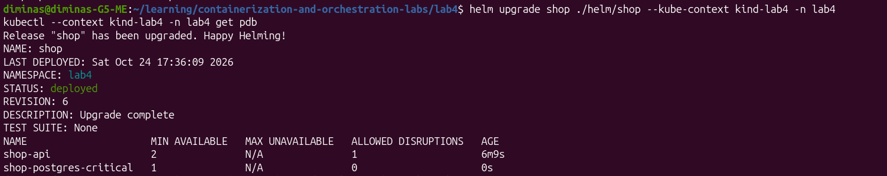

---

# Часть 6 — Pending, preemption и слишком маленький лимит базы

## Как занял CPU requests

На control-plane было `16000m` allocatable CPU, остальные Pod без batch
запрашивали `1220m`. Осталось `14780m` — ровно два batch по `7390m`.
Поставил три реплики и закрепил их на control-plane через nodeSelector,
чтобы свободный worker не скрыл нехватку.

CPU limit batch выставил `14780m`, память оставил `96Mi / 192Mi`, буфер 64 MiB,
один CPU-воркер. Большой request нужен только для опыта с планировщиком:
сам процесс от этого не начинает расходовать 7,39 ядра. Это не рекомендация krr.

Параллельно планировал нагрузку на заказы: 20 запросов/с,
p95 < 300 мс, ошибок < 1%, без пропущенных итераций.
Первый фоновый запуск k6 даже не стартовал: выполнил команду из корня
репозитория и смонтировал не тот каталог. Получил отсутствие `/scripts/orders.js`.
Повторил запуск уже из `lab4`.

## Pending получился

Два новых batch запустились на control-plane, третий остался Pending.
Старая реплика на worker ещё держалась: RollingUpdate не мог закончить замену.

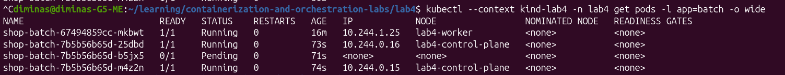

У `shop-batch-7b5b56b65d-b5jx5` были request `7390m`, limit `14780m`,
приоритет `-1000`, Burstable и `PodScheduled: False`.
В событиях — `1 Insufficient cpu`, вторая нода не подходит по selector.
Здесь хорошо видно: scheduler считает requests, а не текущий расход CPU.

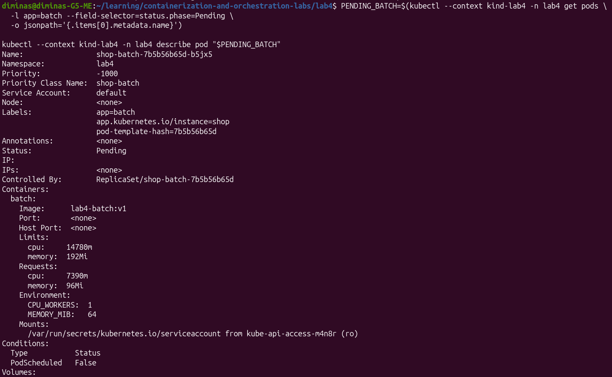

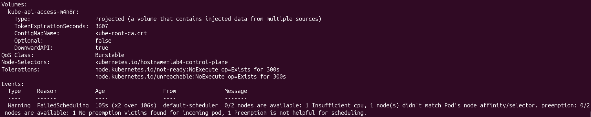

Для этого batch жертв preemption не нашлось: другие batch имеют такой же
приоритет, а у критических и системных Pod он выше.

## API вытеснил batch, но радоваться оказалось рано

Увеличил API с трёх до четырёх реплик. Тогда одна реплика была на control-plane,
две на worker. Правило разнесения требовало новую реплику на control-plane,
чтобы получилось `2+2`, но CPU requests там уже заняты.

После обновления до ревизии 8 scheduler вытеснил
`shop-batch-7b5b56b65d-25dbd` ради нового API. В событии `Preempted` указан
UID API `0b0cbba4-5264-42bc-827a-78a6a601ff7d`.

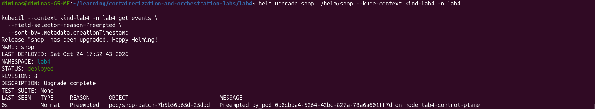

Preemption сработал, место появилось. Только новый API не становился готовым,
потому что PostgreSQL уже был недоступен. Получилось API `3/4`, база `0/1`.
Вместо спокойной проверки SLA пришлось снова разбираться с базой.

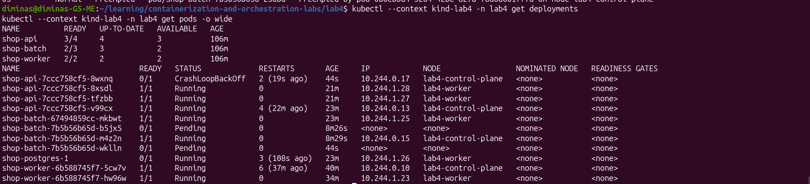

## PostgreSQL: Guaranteed есть, CPU почти нет

Это оказалась самая неприятная часть работы. У базы пошли таймауты probes,
перезапуски и ошибки связи с instance-manager. Последний контейнер завершился
с `137`, `reason: Error`; отметки `OOMKilled` не было. В логах — SIGTERM
и попытка штатной остановки. По одному коду 137 объявлять OOM нельзя.

Счётчики CPU объяснили многое: `nr_periods: 2315`, `nr_throttled: 2267`.
Ограничение срабатывало примерно в 98% периодов! Я приравнял limit к
p95-рекомендации request `16m`, и этой квоты базе с instance-manager
оказалось недостаточно. Класс Guaranteed ресурс из воздуха не добавляет.

Прогон остановил и сохранил в `load/results/stress-first-attempt.json.gz`:
8631 запрос, 8416 ошибок, p95 около 5002 мс. Тут SLA провалился с большим запасом.

Пересчитал ресурсы стратегией `simple-limit` по 100-му процентилю CPU.
Взял два часа истории, чтобы захватить исходные измерения до лимита `16m`:

```bash
KRR_STRATEGY=simple-limit KRR_REPORT=guaranteed-report.json KRR_HISTORY=2 \
  bash ./krr/run.sh --cpu-request 100 --cpu-limit 100
```

В [krr/guaranteed-report.json](krr/guaranteed-report.json) получилось
`37m / 103Mi` для requests и limits PostgreSQL. Перенёс значения в values.

И снова неприятный сюрприз: Cluster уже содержал новые настройки, а Pod
продолжал работать со старыми `16m / 100Mi`. Оператор не мог прочитать статус
instance-manager и закончить обновление. Удалил только зависший Pod:
`kubectl delete pod shop-postgres-1 --wait=false`. PVC с данными сохранился,
CNPG пересоздал Pod с новыми ресурсами.

Проверка наконец показала `Cluster in healthy state`, `READY: true`,
`37m / 103Mi`, Guaranteed. Но спокойствие длилось недолго.
Минутный прогон снова не прошёл: 1179 запросов, 53 ошибки (4,49%),
p95 2,49 с и 22 пропущенные итерации. PostgreSQL опять перезапустился,
в логах появились таймауты и потеря lease. Данные этой попытки лежат
в `load/results/recovery-check.json.gz`.

## Возврат к работающим ресурсам

После двух неудачных вариантов вернул для измерений исходные лимиты:
API `200m / 128Mi`, PostgreSQL `500m / 512Mi`. Requests сделал такими же,
чтобы сохранить Guaranteed. Этот временный профиль лежит
в `helm/calibration-values.yaml`, это не итоговая рекомендация krr.

При слишком жёстком лимите замер уже показывает ограниченное потребление,
а не весь спрос приложения на CPU. Повторять тот же расчёт без изменения
условий оказалось бесполезно.

С этим профилем трёхминутная нагрузка наконец прошла нормально:
3601 заказ, все ответы 201, ошибок и пропусков нет. Средняя задержка 6,93 мс,
p95 8,85 мс, максимум 551,8 мс. После предыдущих таймаутов это было
приятно увидеть. Данные — `load/results/calibration.json.gz`.

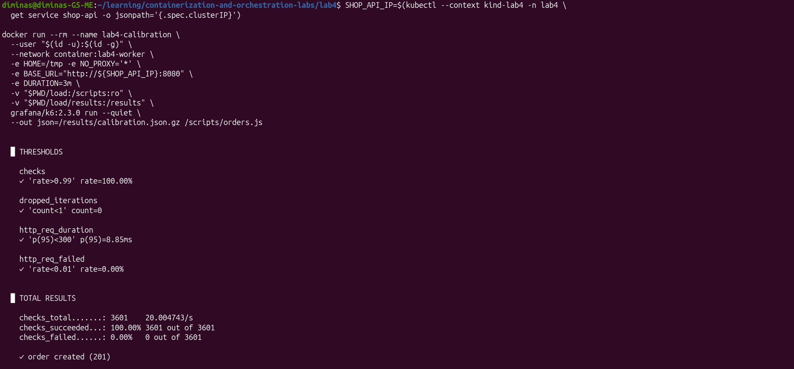

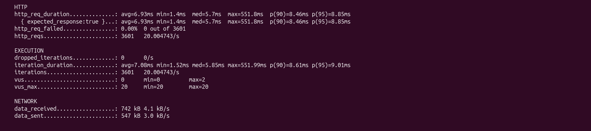

Попытался пересчитать krr по последним 15 минутам, но получил ещё одну ошибку:
`history_duration=0.25` эта версия не принимает, минимум — один час.
Пришлось исправить окно на час, шаг оставил 30 секунд.

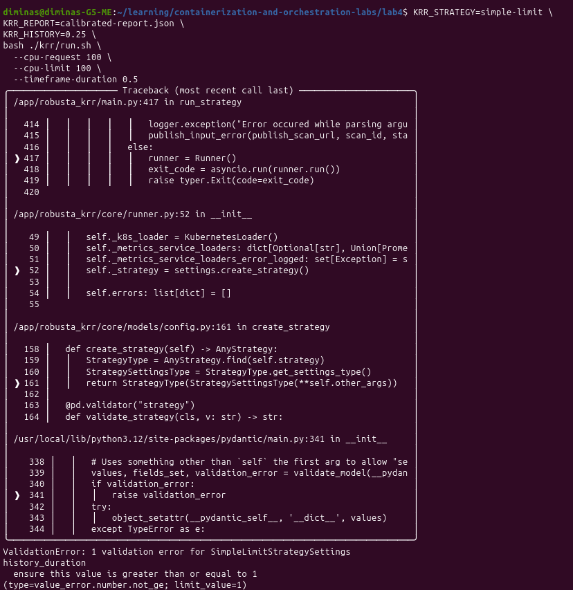

Новый результат сохранил в [krr/calibrated-report.json](krr/calibrated-report.json):
API `10m / 100Mi`, PostgreSQL `40m / 103Mi` для requests = limits.
Предупреждение о короткой истории никуда не делось.

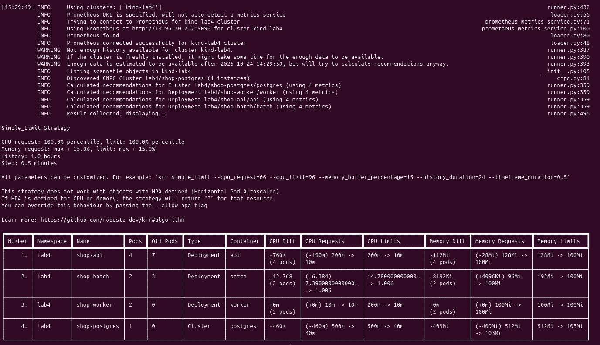

Эти значения повторно не применял. Успешный прогон был с профилем измерений,
а почти такие же `37m / 103Mi` уже не выдержали нагрузку. Максимум
усреднённого CPU за окно измерений не гарантирует квоту для коротких пиков.
Поэтому требование об итоговых ресурсах критического пути из krr
до конца не закрыл.

Pending и preemption в этой части увидел и объяснил. Но успешная нагрузка
после ремонта базы не доказывает SLA в момент самого вытеснения.

---

# Часть 7 — Давление по памяти

## Подготовка без заполнения всей памяти ноутбука

У kind-ноды не было отдельного Docker memory limit, а в `evictionHard`
вообще не был задан порог `memory.available`. Просто увеличивать буфер,
пока закончится вся память ноутбука, здесь не хотелось.

В `helm/memory-baseline-values.yaml` оставил один batch на worker рядом
с PostgreSQL. Вернул CPU `100m / 500m`, оставил буфер 64 MiB,
memory request `96Mi`, limit `1536Mi`. Для API и базы сохранил
работающий профиль `helm/calibration-values.yaml`.

С переключением batch на Recreate тоже вышла заминка: server-side apply
сохранил старый блок `rollingUpdate`, и Kubernetes отклонил Deployment.
Исправил на RollingUpdate с `maxSurge: 0`, `maxUnavailable: 100%`.
Фоновый batch можно остановить целиком при замене, ждать старые реплики незачем.
После ревизии 13 rollout завершился: один batch `1/1` на worker, старых нет.

Скрипт `infra/memory-eviction.py` сохраняет исходную конфигурацию kubelet,
читает память через stats API и ставит hard eviction threshold на 512 MiB
ниже текущего доступного значения. Перед этим проверяет, что на хосте
доступно хотя бы 3 GiB. Период снятия MemoryPressure — две минуты.
Это специально настроенная граница стенда, а не исчерпание всей памяти хоста.

```bash
python3 ./infra/memory-eviction.py
```

Перед настройкой на хосте было доступно 5453 MiB, у worker — 13557 MiB.
Порог получился `13045Mi`, запас до него — 512 MiB. После перезапуска
kubelet нода `Ready=True`, `MemoryPressure=False`, сервисы готовы.

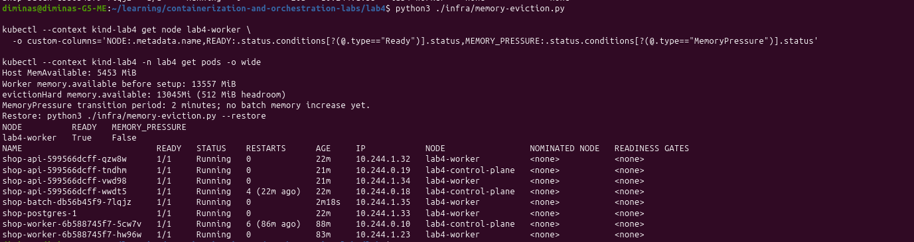

Затем применил `helm/memory-pressure-values.yaml`: batch удерживает 1024 MiB,
request остаётся `96Mi`, limit — `1536Mi`. Так можно пересечь порог ноды,
не доходя до лимита самого контейнера. Параллельно запустил k6 с записью
в `load/results/memory-pressure.json.gz`.

## Eviction удалось поймать

После ревизии 14 batch запустился и примерно через 13 секунд был вытеснен.
Сначала в таблице появилась пугающая строка `ContainerStatusUnknown`.
По ней одной причина непонятна, поэтому открыл `describe`.

У `shop-batch-6d7db56d5b-6xrc8` были:

- статус `Failed`, причина `Evicted`;
- сообщение `The node was low on resource: memory`;
- порог `13045Mi`, доступно `13225572Ki` — около 12915,6 MiB;
- расход batch `1053972Ki` — около 1029,3 MiB, при request `96Mi`
  и limit `1536Mi`;
- QoS Burstable, приоритет `-1000`.

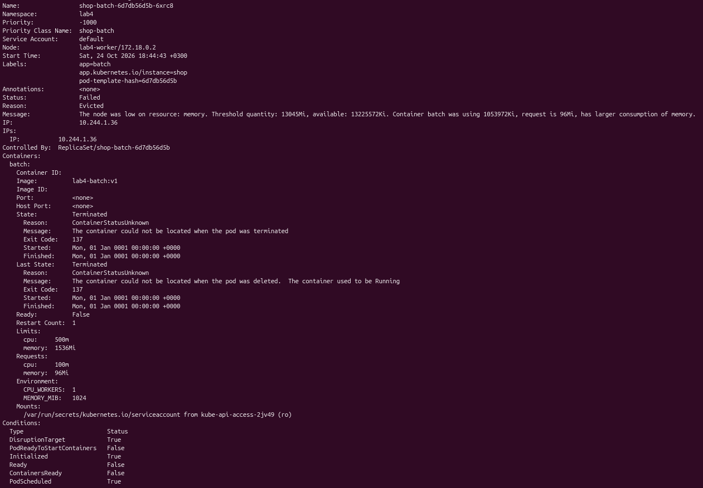

В событиях kubelet появился `Warning Evicted`. Worker остался Ready,
но получил `MemoryPressure=True`. Замена batch ушла в Pending:
worker блокировал taint, control-plane не подходил по nodeSelector.

Четыре API и PostgreSQL продолжали работать `1/1`. У базы и трёх API
перезапусков не было, у четвёртого остались четыре старых.
Хотя бы внутри shop критический путь выдержал, пострадал batch.

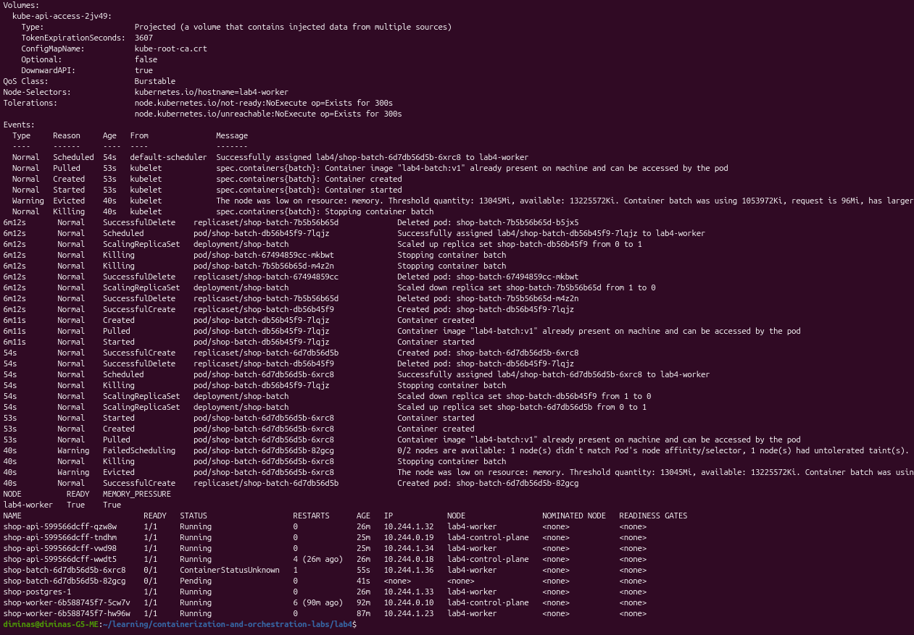

## Почему это не OOMKilled

У batch было около 1029 MiB потребления при собственном лимите 1536 MiB.
Его вытеснил kubelet из-за порога ноды: это явно написано в причине Pod
и событии. При OOM по лимиту контейнера ограничение срабатывает в cgroup,
а причиной завершения ожидается `OOMKilled`.

Здесь контейнер показывал `ContainerStatusUnknown` и код 137,
но у самого Pod стояло `Evicted`. Поэтому одного exit code недостаточно:
нужно смотреть причину Pod и события.

Низкий приоритет и превышение memory request делают batch удобной жертвой.
Но kubelet учитывает также потребление остальных Pod — название QoS
не задаёт безусловный порядок на всей ноде.

И тут обнаружилась важная неприятная деталь. Когда позже посмотрел события
во всех namespace, выяснилось, что Grafana была вытеснена в 18:44:53 МСК,
batch — в 18:44:57, Prometheus Operator — в 18:47:08. То есть первым
на всей ноде оказался вовсе не batch. Пока я смотрел только namespace
приложения, эта часть картины оставалась за кадром.

Eviction batch и сохранение API с базой подтвердились. А вот требование
«batch первым» для всей ноды по этому опыту не выполнено.

## Возврат к обычному состоянию

Ревизией 15 вернул `memory-baseline-values.yaml`: буфер batch снова 64 MiB.
Командой `python3 ./infra/memory-eviction.py --restore` восстановил исходные
настройки kubelet. Обе ноды Ready, новый batch `1/1`, API и база готовы.
Старая строка `ContainerStatusUnknown` осталась от уже вытесненного Pod,
а не от новой работающей реплики.

---

# Часть 8 — Что получилось с SLA

## Условия

До перегрузки задал цель: 20 заказов/с, p95 HTTP-задержки меньше 300 мс,
ошибок меньше 1%, пропущенных итераций нет. Проверяю `POST /order`
и ответ HTTP 201.

Прогон во время eviction шёл с 18:44:25 до 18:49:25 МСК 24 октября 2026 года.
Память batch увеличил в 18:44:43, событие `Evicted` произошло в 18:44:57
(`firstTimestamp=2026-10-24T15:44:57Z`). Значит, момент вытеснения действительно
попал в нагрузочный тест.

## Результат при давлении по памяти

На этот раз всё прошло хорошо:

| Показатель | Результат | Условие |
| --- | --- | --- |
| Запросы / созданные заказы | 6000 / 6000 | HTTP 201 |
| HTTP-ошибки | 0% | < 1% |
| p95 HTTP-задержки | 108,86 мс | < 300 мс |
| Средняя задержка | 20,47 мс | Для сравнения |
| Максимальная задержка | 474,30 мс | Ограничение задано для p95 |
| Пропущенные итерации | 0 | 0 |

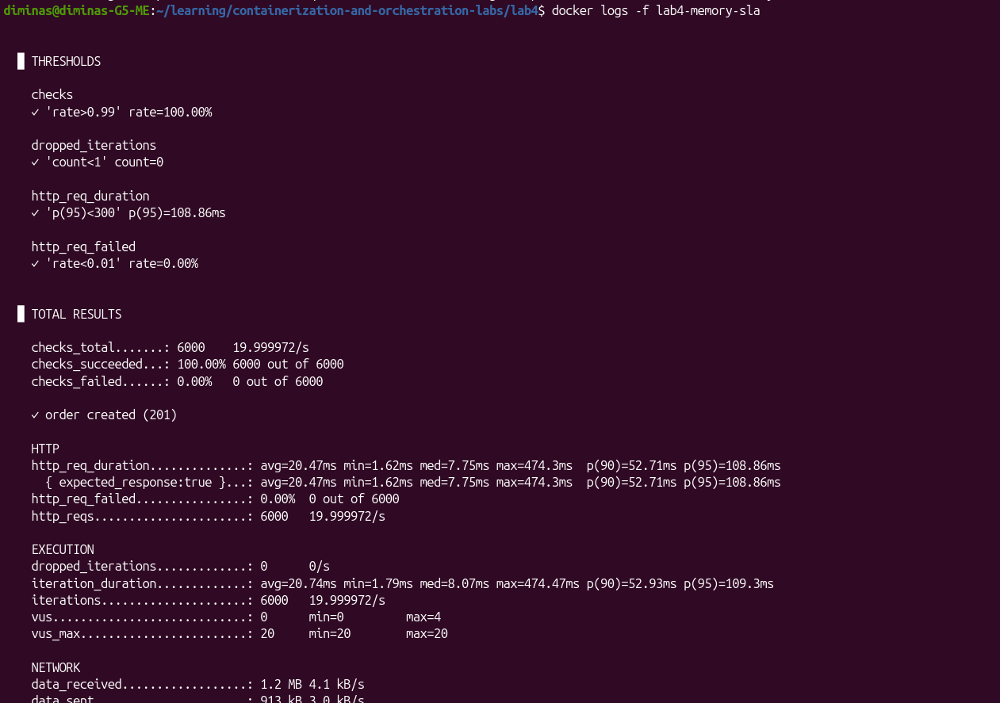

Графики построил скриптом `load/plot-results.py` по точкам из
`load/results/memory-pressure.json.gz`. Времена событий лежат
в `load/memory-events.json`. На графике есть отдельные запросы,
p95 за неперекрывающиеся 10-секундные окна и отметка eviction.

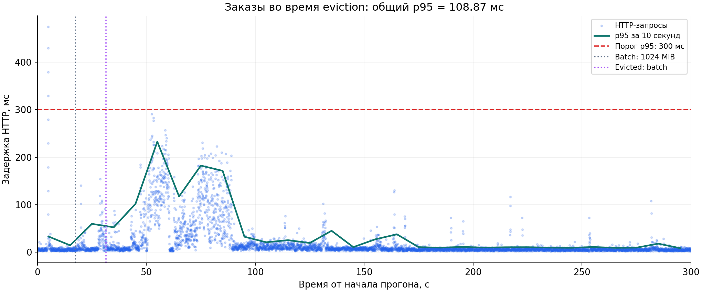

Самый высокий p95 среди 10-секундных окон — 232,81 мс, тоже ниже 300 мс.
Отдельные запросы выходили за 300 мс, но условие поставлено для 95-го
процентиля, поэтому это не противоречит результату.

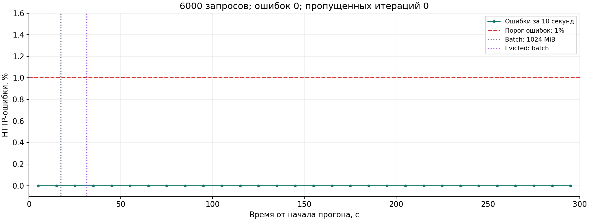

Batch вытеснен, его замена ждала размещения, а все 6000 заказов созданы.
Для этого опыта с памятью SLA выдержан.

## Где результат остался неполным

При preemption всё было значительно хуже: база перезапускалась,
первый прогон SLA не выдержал. Успешный тест после её восстановления
не заменяет проверку прямо в момент preemption. Повторять этот опыт
я не стал, поэтому здесь оставляю получившийся результат, без заявления,
что оба сценария прошли успешно.

Ещё одно ограничение: удачный прогон сделан с `helm/calibration-values.yaml`,
а не с последними рекомендациями krr `10m / 100Mi` для API и `40m / 103Mi`
для PostgreSQL. Близкий вариант ресурсов базы уже приводил к сбоям.
Этот пункт задания тоже до конца не закрыт.

---

# Часть 9 — Мониторинг и ещё немного борьбы с Grafana

## Что добавил в чарт

ServiceMonitor разместил в `lab2`, откуда Prometheus выбирает его по
`release: monitoring`. Он собирает `/metrics` API и worker из `lab4`
через сервисы с меткой `monitoring: shop`, интервал — 15 секунд.

ConfigMap с `grafana_dashboard: "1"` содержит дашборд
`Shop — Lab 4: overload`, UID `shop-lab4`. На панелях вывел:

- готовность API, PostgreSQL, batch и число Evicted batch;
- скорость создания и обработки заказов;
- рабочую память контейнеров и CPU throttling критического пути;
- MemoryPressure нод и Pending batch.

Счётчики заказов приходят через ServiceMonitor, ресурсы и состояния —
из cAdvisor и kube-state-metrics. HTTP-гистограмму сервисы не экспортируют,
поэтому задержки и ошибки смотрю на графиках k6 из части 8.

## Три алерта

| Алерт | Условие в течение 1 минуты | Уровень | Зачем нужен |
| --- | --- | --- | --- |
| ShopApiInsufficientReplicas | Доступно меньше 3 реплик API | critical | У входа в критический путь уменьшается запас доступности |
| ShopPostgresUnavailable | Нет готового PostgreSQL | critical | Без базы заказ не создаётся |
| ShopBatchUnavailable | Доступно меньше 1 реплики batch | warning | Фоновая работа остановилась; это повод проверить Pending и eviction |

Правила находятся в PrometheusRule, пороги и выдержка — в values.
Алерт batch намеренно warning: его остановка ещё не означает, что заказы
не работают. Причину нужно смотреть отдельно, потому что это может быть
и scale-down, и нехватка ресурсов.

## Проверка firing

Для проверки через Helm временно выставил `batch.replicas=0`.
Критический путь оставил работать. Prometheus сначала показал pending,
после `for: 1m` — `FIRING (1)`.
На скрине видны `deployment="shop-batch"`, `namespace="lab4"`,
`severity="warning"` и ноль доступных реплик.

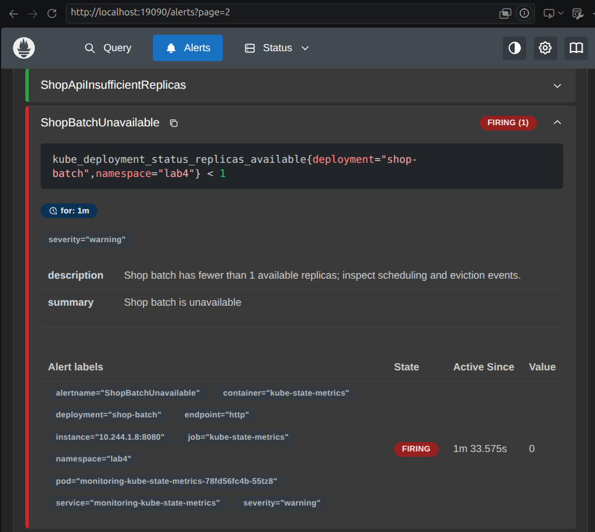

Это контролируемый scale-down, а не ещё один eviction.
После скрина вернул одну реплику batch через Helm.

## Grafana не захотела открывать дашборд с первого раза

Под конец очень хотелось просто увидеть готовые панели. Вместо них получил
`Dashboard not found`. JSON в ConfigMap был корректным, sidecar записал файл,
но provisioning выдавал `deprecatedInternalID ... is already in use`.

Имя `shop.json` осталось от старого дашборда. Заменил его на
`shop-lab4.json`, UID `shop-lab4` и адрес `/d/shop-lab4` сохранил.
Импорт прошёл, но затем Grafana вообще перестала отвечать на `/api/health`:
Pod оказался `2/3 Ready`. После истории с базой это уже выглядело
как ещё один лишний круг ремонта.

Перезапустил Deployment Grafana. Команда ожидания завершилась по таймауту
90 секунд, но сам rollout продолжился и позже закончился успешно.
Новый Pod `monitoring-grafana-5767df9d55-jb5wk` стал `3/3`,
`/api/health` вернул HTTP 200 и `database: ok`. Через API проверил,
что дашборд с десятью панелями действительно загрузился.

## Готовый дашборд

Наконец панели открылись. На скринах выбран диапазон Last 1 hour.
Сверху видны четыре API, один PostgreSQL, один работающий batch
и один Evicted Pod batch. На графике заказов — прогоны примерно по 20 запросов/с.

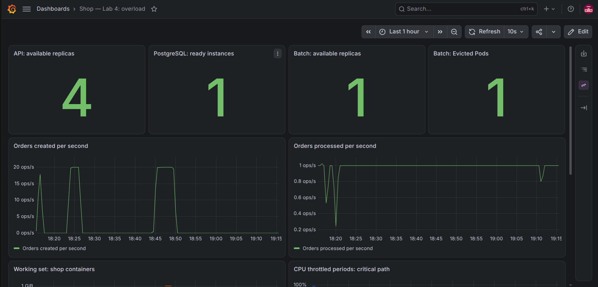

Ниже видно, как память batch поднималась примерно до 1 GiB,
worker получал MemoryPressure, а batch оставался Pending.
На истории throttling также заметна разница между прежними слишком
маленькими CPU-квотами и профилем, с которым нагрузка прошла.

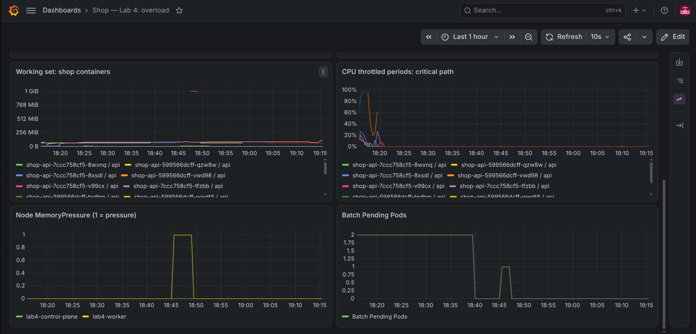

Мониторинг в этой части заработал: шаблоны находятся в чарте,
три алерта загружены, firing одного из них пойман, Grafana показывает данные.
После восстановления batch все три алерта вернулись в inactive,
проверка правил показывала `health=ok`.

---

# Что в итоге

Удалось увидеть разнесение API, Pending по requests, preemption batch
и eviction при давлении по памяти. Во время опыта с памятью критический путь
сохранился, 6000 заказов созданы без ошибок. Мониторинг и графики тоже работают.

Но назвать всю работу полностью успешной было бы нечестно:

- Последние рекомендации krr для критического пути не стали проверенным
  итоговым профилем. Работает вариант из `helm/calibration-values.yaml`;
  уменьшение CPU-квоты PostgreSQL раньше приводило к сбоям.
- Batch оказался не первой жертвой на всей ноде: раньше вытеснило Grafana.
  API и PostgreSQL при этом сохранились.
- SLA прошёл при eviction, но провалился при первом preemption.
  Повторять preemption я не стал.

Списать всё на ноутбук было бы удобно, но успешные прогоны после изменения
ресурсов показывают, что дело было не только в площадке. Самый наглядный
урок здесь — зелёный статус и красивое название Guaranteed не заменяют
проверку реального заказа под нагрузкой.

После опытов оставил один batch с буфером 64 MiB, настройки kubelet вернул
к исходным. Текущий рабочий вариант разворачивается из `lab4` так:

```bash
helm upgrade --install shop ./helm/shop \
  --kube-context kind-lab4 -n lab4 \
  -f ./helm/calibration-values.yaml \
  -f ./helm/memory-baseline-values.yaml
```
