# Лабораторная работа 5 — Zero-trust сеть с доказательством

## Структура проекта

```text
lab5/
├── Dockerfile
├── README.md
├── lab.md
├── go.mod
├── go.sum
├── monitoring.yaml
├── services/
│   ├── api/
│   │   └── main.go
│   └── worker/
│       └── main.go
├── policies/
│   ├── no-latest.yaml
│   ├── no-privileged.yaml
│   ├── require-app-label.yaml
│   ├── require-limits.yaml
│   ├── require-non-root.yaml
│   └── tests/
│       ├── no-app-label.yaml
│       ├── no-limits.yaml
│       ├── latest.yaml
│       ├── privileged.yaml
│       ├── root.yaml
│       └── valid-pod.yaml
├── helm/
│   └── shop/
│       ├── Chart.yaml
│       ├── values.yaml
│       └── templates/
│           └── templates/
│           │   └── allow-app.yaml
│           │   ├── allow-dns.yaml
│           │   ├── allow-postgres.yaml
│           │   └── default-deny.yaml
│           ├── api-deployment.yaml
│           ├── api-service.yaml
│           ├── grafana-dashboard.yaml
│           ├──hubble-service-monitor.yaml
│           ├──network-alerts.yaml
│           ├── postgres-cluster.yaml
│           ├── prometheus-rule.yaml
│           ├── service-monitor.yaml
│           ├── worker-deployment.yaml
│           └── worker-service.yaml
├── images/
│   ├── part0/
│   ├── part1/
│   ├── part2/
│   ├── part3/
│   ├── part5/
│   └── part6/
│   └── part7/
```

---

# Часть 0 — Выбор CNI

### Выбор сетевого плагина

Был выбран **Cilium** с инструментом сетевой наблюдаемости **Hubble**, но рассматривались два варианта:
- **Calico** — обеспечивает сетевую связность и применение NetworkPolicy
- **Cilium** — использует технологию eBPF, поддерживает NetworkPolicy и предоставляет Hubble для наблюдения за сетевыми соединениями

Так как нам необходимо не только ограничить взаимодействие между подами, но и обнаружить скрытую ошибку сетевой конфигурации, подойдет как раз **Cilium**, а в связке с **Hubble** можно удобно увидеть источники, получателей и причины блокировки соединений

### Настройка Cilium

Для развертывания используется **k3d**, создан кластер `lab5` с одной управляющей и двумя рабочими нодами. Также были отключены стандартные сетевой плагин и контроллер, чтобы использовать Cilium.

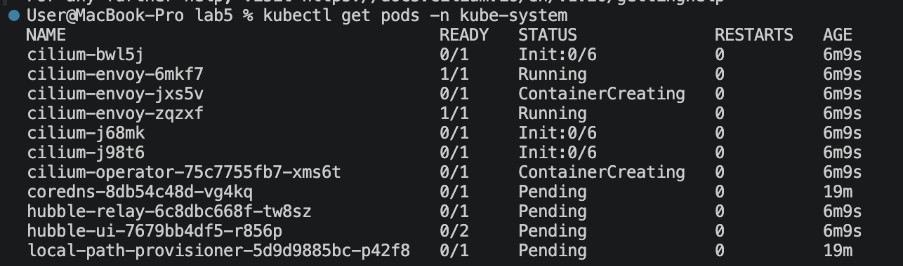


# Часть 1 — Развертывание shop и исследование сети пода

Приложение shop было развернуто в Kubernetes-кластере k3d с использованием Helm-чарта из лабораторной работы №3. После развертывания все 6 подов перешли в состояние Running и были распределены между тремя нодами кластера.

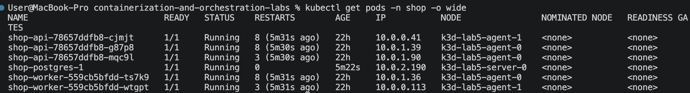

### Исследование сетевого интерфейса

Для исследования был выбран под shop-api-78657ddfb8-cjmjt с IP-адресом 10.0.0.41, расположенный на ноде k3d-lab5-agent-1. Так как docker-образ минимальный и не содержит сетевых утилит, исследование выполнялось через nsenter, используя PID процесса контейнера.

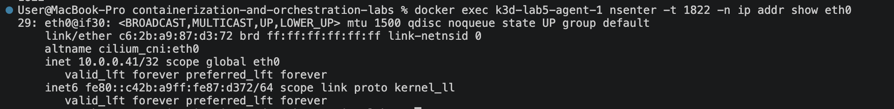

Далее был обнаружен парный интерфейс veth

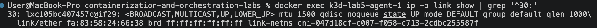

Внутри пода: eth0@if30, индекс 29, а на ноде: lxc105bc407457c@if29, индекс 30. Взаимные индексы подтверждают, что интерфейсы образуют veth-пару.


### Проверка связи между подами на разных нодах

В качестве теста были взяты 2 пода и из сетевого пространства api-пода был пропингован второй под:

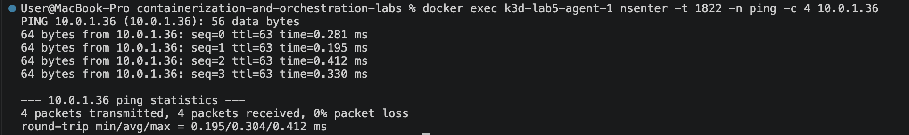


# Часть 2 — Хаос подов

Отличия типов Kubernetes Service:
- **NodePort** открывает заданный порт на нодах и позволяет обращаться к сервису извне кластера
- **LoadBalancer** предоставляет внешний адрес через балансировщик нагрузки
- **Headless Service** не создает виртуальный ClusterIP, а позволяет через DNS получать адреса соответствующих endpoints

Для проверки отказоустойчивости api был опубликован через Kubernetes Service типа `NodePort`, а настройки Service были вынесены в `values.yaml`

### 2.1. Организация хаоса подов

Был написан скрипт `chaos.sh`, который каждые 15 секунд случайным образом выбирает и удаляет один из подов. После удаления Kubernetes автоматически создает новый под для восстановления заданного количества реплик.

Параллельно с удалением подов был запущен скрипт `load.sh`, который отправлял запросы к api из тестового пода. По итогам эксперимента получены следующие результаты:

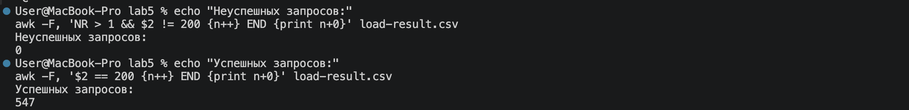

### 2.2. Мониторинг восстановления реплик

Для наблюдения использовались Prometheus и Grafana из лабораторной работы №2. В Grafana была создана панель, которая отображала запрос, вычисляющий разницу между требуемым и фактическим количеством доступных реплик. На графике наблюдались кратковременные увеличения значения от `0` до `1`, то есть при удалении одного из подов количество доступных реплик уменьшалось, но Kubernetes тут же восстанавливал заданное состояние.

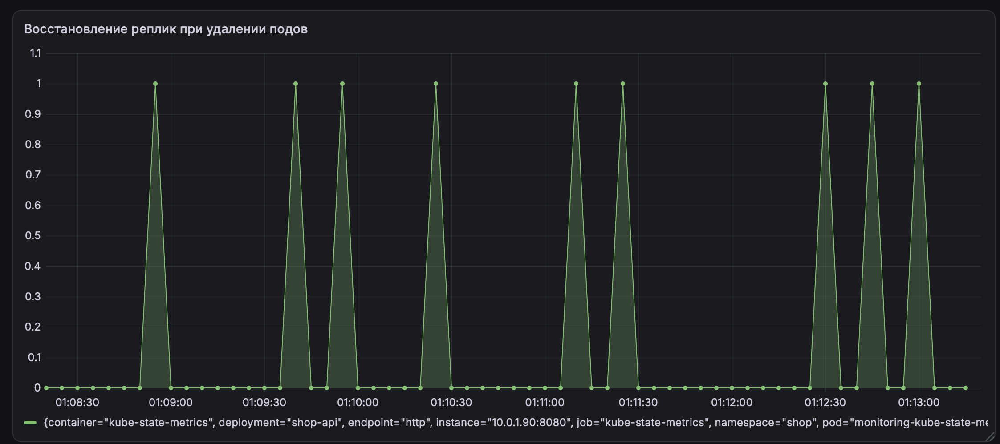

### 2.3. Почему Service сохраняет доступность
- **DNS** – позволяет обращаться к сервису по имени, а не по IP-адресу
- **Service** – обеспечивает постоянный адрес для обращения к приложению, даже если поды удаляются и создаются заново
- **EndpointSlice** — хранит список доступных подов и обновляет его при их удалении или создании
- **kube-proxy** — направляет запросы от Service к нужным подам

В кластере используется Cilium, поэтому способ передачи трафика зависит от его настроек и работы kube-proxy. **iptables и IPVS** - два способа, с помощью которых kube-proxy направляет запросы к подам. iptables использует сетевые правила, а IPVS - встроенный механизм балансировки нагрузки. На небольших кластерах разница незначительна, но при большом количестве сервисов IPVS может работать эффективнее.

В случае нашей лабораторной работы Service позволил клиенту продолжать отправлять запросы по одному адресу, даже когда поды удалялись и создавались заново с новыми ip.

### 2.3. Режим kube-proxy
В кластере используется kube-proxy в режиме iptables (есть KUBE-SERVICES и KUBE-SVC). С их помощью запросы к Service перенаправляются на доступные поды приложения.

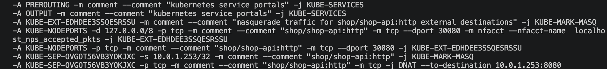


# Часть 3 — Целевая матрица доступа

Для определения необходимых соединений были изучены api и worker: оба компонента подключаются к PostgreSQL, прямое взаимодействие между api и worker не требуется. Необходимо разрешить клиентам доступ к api, а api и worker — подключение к PostgreSQL. Также необходимо сохранить доступ к DNS для обращения к сервисам по именам

| Источник | Получатель | Порт | Решение |
| --- | --- | --- | --- |
| Клиент |	api	| 8080 | Разрешить |
| api |	PostgreSQL |	5432 |	Разрешить |
| Worker |	PostgreSQL | 5432 |	Разрешить |
| api |	DNS	| 53 TCP/UDP |	Разрешить |
| Worker |	DNS | 53 TCP/UDP |	Разрешить |
| Посторонний под |	PostgreSQL	| 5432 |	Запретить |
| api |	Worker | 8082 |	Запретить |
| Worker |	api |	8080 |	Запретить |
| Посторонний под |	api | 8080 | Запретить |
| Остальные соединения | Любой под |	— |	Запретить |

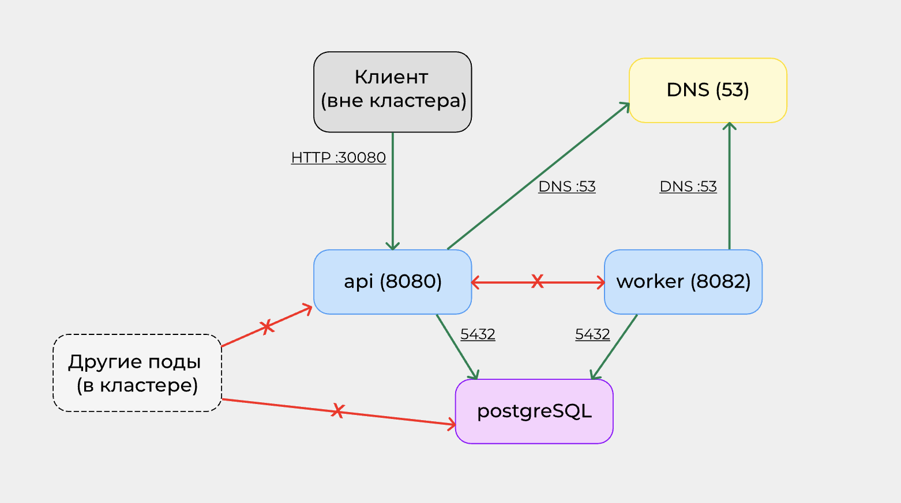


# Часть 4 — Настройка zero-trust

Для ограничения взаимодействия между подами были созданы сетевые политики Kubernetes NetworkPolicy, все они реализованы в виде шаблонов Helm-чарта `shop` в папке `helm/shop/templates/policies/`:

| Название | Описание |
|---|---|
| `shop-default-deny` | Запрещает весь входящий и исходящий трафик по умолчанию |
| `shop-api` | Разрешает входящие HTTP-запросы к api и подключения api к PostgreSQL |
| `shop-worker` | Разрешает worker подключаться к PostgreSQL |
| `shop-postgres` | Разрешает подключения к базе данных от api, worker и необходимые служебные соединения |
| `shop-dns` | Разрешает DNS-запросы по TCP и UDP на порту 53 |


Основой zero-trust стала политика `shop-default-deny`, которая применяется ко всем подам пространства имен `shop`:

```yaml
spec:
  podSelector: {}
  policyTypes:
    - Ingress
    - Egress
```

Дополнительно разрешен исходящий DNS-трафик по TCP и UDP на порт `53`, чтобы приложения могли находить сервисы по именам. Для PostgreSQL также предусмотрены служебные порты `8000` и `9187`, необходимые для управления базой и сбора метрик, и исходящее подключение к Kubernetes api на `443/TCP`.


# Часть 5 — Матрица на практике

Результаты проверки: 

| Источник | Получатель | Ожидание | Факт |
| --- | --- | --- | --- |
| test-client |	api:8080 | ALLOW | ALLOW |
| api |	postgreSQL:5432 |	ALLOW |	ALLOW |
| worker |	postgreSQL:5432 | ALLOW |	ALLOW |
| test-client |	postgreSQL:5432	| DENY |	DENY |
| api |	worker:8082 | DENY | DENY |
| worker |	api:8080 |	DENY |	DENY |
| api |	DNS:53 | ALLOW |	ALLOW |
| worker |	DNS:53 |	ALLOW |	ALLOW |

Проверки показали, что настроенные NetworkPolicy обеспечивают необходимое взаимодействие компонентов приложения и блокируют запрещенные соединения. Примеры резульатов:

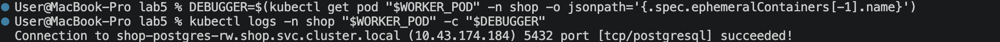

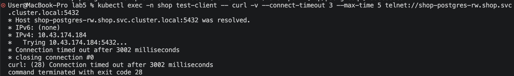

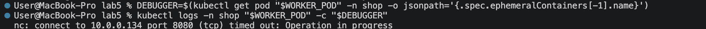

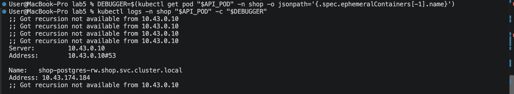


# Часть 6 — Найти поломку связности

Был создан скрипт `scripts/break.sh`, который случайным образом выбирает одну из трех ошибок и изменяет конфигурацию NetworkPolicy через `values.yaml`.

| Название | Описание |
|---|---|
| Порт PostgreSQL 5432 → 5433 | api и Worker потеряют доступ к БД |
| Метка PostgreSQL shop-postgres → wrong-postgres | Правила перестанут правильно выбирать PostgreSQL |
| DNS-порт 53 → 5353 | DNS-запросы перестанут проходить |

### 6.1. Поиск и диагностика

После запуска `break.sh` были выполнены проверки соединений между компонентами приложения. Для анализа использовался **Hubble UI**, отображающий сетевой трафик Kubernetes, источники и получателей соединений, порты и результаты обработки пакетов.

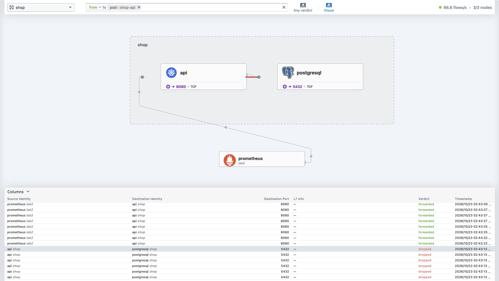

При исследовании обнаружены заблокированные подключения от api к PostgreSQL на порту `5432`, случайно выбранная ошибка изменила разрешенный порт PostgreSQL с `5432` на `5433`. Для восстановления доступа в `helm/shop/values.yaml` было возвращено правильное значение:

```yaml
networkPolicy:
  postgres:
    port: 5432
```

### 6.4. Повторная проверка матрицы доступа

Для повторной проверки матрицы подготовлен скрипт `scripts/test-matrix.sh`, который последовательно выполняет сетевые тесты. В ходе повторных проверок результаы пожтвердились

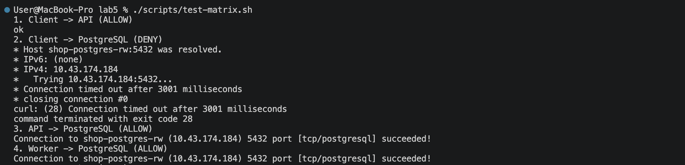


# Часть 7 — Мониторинг

Для мониторинга использовалась связка **Prometheus + Grafana** из лабораторной работы №2. Для подключения сервиса к Prometheus в Helm-чарт `shop` добавлен шаблон `hubble-service-monitor.yaml`, после применения Prometheus начал собирать метрики Hubble. 

Для мониторинга использовались следующие показатели:
| Метрика | Назначение |
|---|---|
| `hubble_drop_total` | Количество отброшенных сетевых пакетов |
| `hubble_tcp_flags_total` | TCP-пакеты с различными флагами |
| `coredns_dns_responses_total` | DNS-ответы с различными кодами |

В Helm-чарт был добавлен файл `network-alerts.yaml` с ресурсом `PrometheusRule`, содержащим три алерта:

| Алерт | Условие | Назначение |
|---|---|---|
| `NetworkPolicyDrops` | Появление отброшенного сетевого трафика | Обнаружение блокировок NetworkPolicy |
| `DNSErrors` | Появление DNS-ответов `SERVFAIL` | Обнаружение ошибок DNS |
| `TCPConnectionDrops` | Появление TCP-пакетов с флагом `RST` | Обнаружение возможных проблем с TCP-соединениями |


### 7.1. Проверка срабатывания алертов

Для проверки была создана серия запрещенных подключений от `test-client` к PostgreSQL на порту `5432`. Поскольку NetworkPolicy запрещает клиенту доступ к PostgreSQL, такие запросы создают заблокированный сетевой трафик.

В Prometheus были зафиксированы следующие состояния:

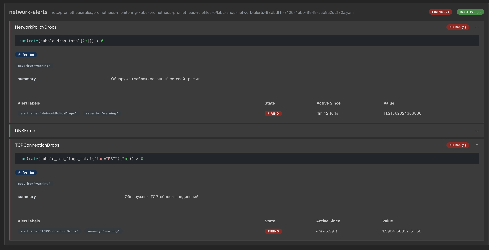

Таким образом, подтверждено срабатывание двух из трех настроенных алертов. Состояние `INACTIVE` у `DNSErrors` соответствует отсутствию DNS-ошибок `SERVFAIL` в момент проверки.

### 7.2. Создание дашборда Grafana

В Grafana был создан дашборд, содержащий три графика. Первый график показывает интенсивность отброшенного сетевого трафика, второй отображает частоту TCP-сбросов, а третий позволяет отслеживать DNS-ответы по кодам `NOERROR`, `NXDOMAIN`.

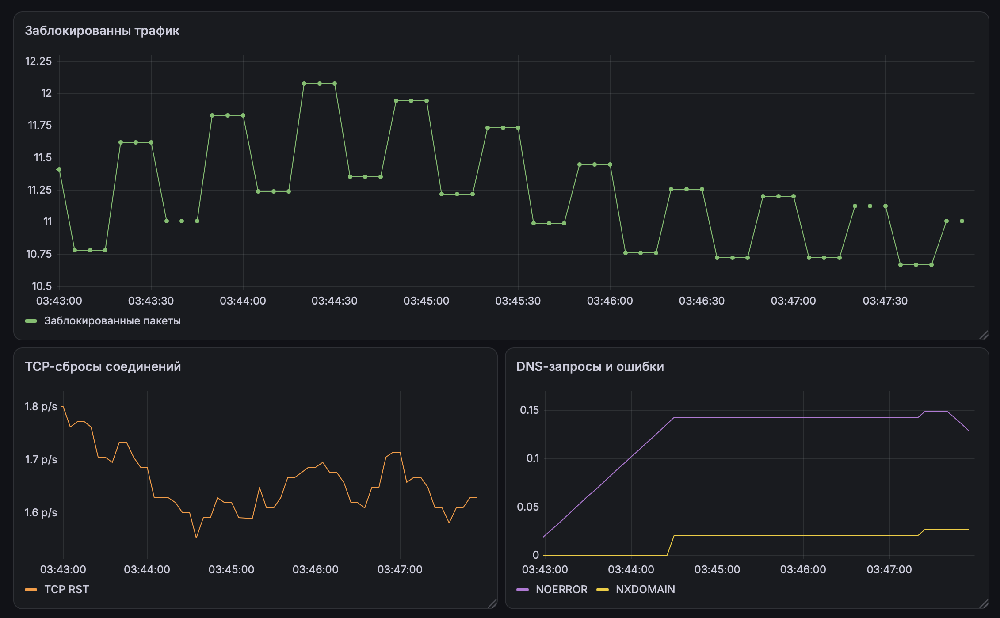

